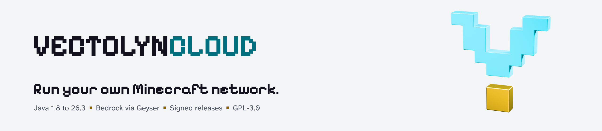

<h1 align="center">
  <picture>
    <source media="(prefers-color-scheme: dark)" srcset="branding/png/readme-header-dark@2x.png">
    
  </picture>
</h1>

<p align="center"><strong>Run your own Minecraft network.</strong></p>

[](https://github.com/VectoDE/VectolynCloud/actions/workflows/ci.yml)
[](https://github.com/VectoDE/VectolynCloud/actions/workflows/codeql.yml)
[](https://scorecard.dev/viewer/?uri=github.com/VectoDE/VectolynCloud)
[](https://www.bestpractices.dev/projects/16102)
[](https://github.com/VectoDE/VectolynCloud/releases)
[](LICENSE)

**English** · [Deutsch](README.de.md)

Vectolyn is an open-source kit (GPL-3.0) for running your own Minecraft network, on which Java players (1.8 to 26.3) and Bedrock players play together.

We do not run a network ourselves: there is no official server, domain, hosted website, Discord bot or store. The website, Discord bot and store are code in this repository. You configure them with your own bot token and your own Stripe account and host them yourself.

You run `java -jar VectolynCloud.jar` on Windows, Linux, macOS, in Docker or on Pterodactyl and answer a setup assistant. The cloud then downloads the server software, sets up the database and starts the network you chose: proxy, lobby, game modes and minigames. A release contains `VectolynCloud.jar`, start scripts for Windows, Linux and macOS, and a Docker image on GHCR, all signed and with build provenance. Plugin jars are not attached to releases. The Dockerfile, the compose file and the Pterodactyl egg live in this repository.

## Status

**Stage 2 of 8: VectolynCloud core.** Stage 1, the foundation, is finished. The signed pre-release [v0.1.1-dev](https://github.com/VectoDE/VectolynCloud/releases/tag/v0.1.1-dev) contains `VectolynCloud.jar`, the start script archives and the checksums; the container image is tagged `0.1.1-dev` and `dev`. It is an early pre-release for trying things out, not for production.

Built in stage 2: launcher, configuration, templates, downloads, setup assistant, console, node with static and dynamic services, autoscaling, cloud channel and bridges, REST/WebSocket API, database setup, backups, monitoring, start scripts, systemd unit, Docker image and Pterodactyl egg. Still open: several nodes over TLS ([#73](https://github.com/VectoDE/VectolynCloud/issues/73)), the update system ([#74](https://github.com/VectoDE/VectolynCloud/issues/74) to [#77](https://github.com/VectoDE/VectolynCloud/issues/77)), the managed legacy proxy ([#78](https://github.com/VectoDE/VectolynCloud/issues/78)) and the stage wrap-up ([#80](https://github.com/VectoDE/VectolynCloud/issues/80)). The plugin, lobby, game modes, dashboard, bot, website and store belong to later stages and are not built yet. The *Architecture* section marks what is planned.

- Roadmap and progress: [Vectolyn Roadmap](https://github.com/users/VectoDE/projects/11)
- Current stage: [#11 Stage 2: VectolynCloud core](https://github.com/VectoDE/VectolynCloud/issues/11)

| Stage | Content |
|---|---|
| 1 | Foundation: repository, build, config fixes |
| 2 | VectolynCloud core |
| 3 | Vectolyn plugin base: core, permissions, messaging, portals/End, sync, version adapters |
| 4 | Lobby |
| 5 | Survival, Creative, Mod server |
| 6 | Minigames and anti-cheat |
| 7 | Brand and resource pack |
| 8 | Dashboard, Discord bot, website, store |

## Where to start

| You are | Start here |
|---|---|
| New to Minecraft servers | [Overview](https://github.com/VectoDE/VectolynCloud/wiki/Overview), [Getting Started](https://github.com/VectoDE/VectolynCloud/wiki/Getting-Started) and the [FAQ](https://github.com/VectoDE/VectolynCloud/wiki/FAQ) in the wiki, then the [quick start](#quick-start) below |
| Owner of a network | [Quick start](#quick-start), then [Server Network](https://github.com/VectoDE/VectolynCloud/wiki/Server-Network) and [Crossplay](https://github.com/VectoDE/VectolynCloud/wiki/Crossplay) in the wiki |
| Admin | [Running VectolynCloud](docs/cloud/operations.md) (Windows, Linux with systemd, macOS, Docker, Pterodactyl), [setup](docs/cloud/setup.md), [console](docs/cloud/console.md), [backups](docs/cloud/backup.md), [monitoring](docs/cloud/monitor.md), [API](docs/cloud/api.md) |
| Developer | [Build](#build), [architecture](docs/cloud/architecture.md), [Contributing](CONTRIBUTING.md) |
| Security reviewer | [SECURITY.md](SECURITY.md), [OpenSSF](docs/openssf.md), [dependency verification](docs/dependency-verification.md), [rights audit](docs/cloud/rights-audit.md) |

The README, the contributing guide and the wiki exist in English and German.

## Architecture

```
 Java 1.8 to 26.3         Bedrock
        │                    │
        ▼                    ▼
 ┌──────────────────────────────────────┐
 │ Proxy: Velocity                      │
 │ ViaVersion/ViaBackwards/ViaRewind    │
 │ Geyser + Floodgate                   │
 └──────────────────┬───────────────────┘
                    │ modern forwarding
   ┌────────┬───────┼─────────┬─────────┬───────────┐
   ▼        ▼       ▼         ▼         ▼           ▼
 Lobby  Survival Creative  Mod (Fabric) End    Minigames (planned)
   └────────┴───────┴─────────┴─────────┴───────────┘
                    │
                MariaDB

 VectolynCloud starts, scales and watches all of the above.
```

- **Proxy:** Velocity is the single entry point. Geyser and Floodgate let Bedrock clients in, the Via plugins translate older Java versions. Backends run the newest Minecraft version.
- **Backends:** Paper for Lobby, Survival, Creative, End and (later) Minigames. Fabric for the mod server.
- **No command blocks:** they are off on every server and cannot be switched back on; the Paper and 1.8.8 bridges also remove them from the worlds. Staff commands only work for the console and players with the permission; the [rights audit](docs/cloud/rights-audit.md) lists every one.
- **VectolynCloud** (stage 2, built): a Java node with console and setup assistant. It downloads and verifies server software, manages JREs and the database, generates secrets, scales minigame servers and offers a REST/WebSocket API. The assistant asks its questions in the console on the first start; after that you use config files and console commands. The web dashboard will cover everything as well, first-time setup included (stage 8, planned). In the assistant or the config you mark each of the seven servers and each minigame group as wanted or not. The cloud only builds wanted servers: it renders the server's template (`templates/<Server>/` in this repository, shipped inside the jar) into its home, downloads the software, fills in the secrets and starts them. Servers you do not want are never created, and neither the proxy nor the lobby refers to them.
- **One Vectolyn plugin** (planned, stage 3): several Gradle modules (core, permissions, social, moderation, stats, economy, lobby, portals and more) bundled into one jar per platform: `Vectolyn-Paper.jar`, `Vectolyn-Velocity.jar`, `Vectolyn-Fabric.jar`. It will replace LuckPerms, TAB, WorldEdit, WorldGuard, PlaceholderAPI, ProxyPortal and Chunky.

Third-party software is limited to a necessary base: Paper, Velocity, Fabric and Fabric API, Geyser, Floodgate, ViaVersion, ViaBackwards, ViaRewind, the performance mods Lithium, FerriteCore, ServerCore and FabricProxy-Lite, and MariaDB/MySQL.

More detail: [Architecture in the wiki](https://github.com/VectoDE/VectolynCloud/wiki/Architecture).

## Repository layout

```
VectolynCloud/
  cloud/                  VectolynCloud, one Gradle module per part: launcher, node, config, api,
                          console, setup, database, download, template, network, backup, monitor,
                          cluster
    dist/                 start scripts, Docker, Pterodactyl egg, systemd unit, vectolyn.env.example; manual/ holds the old Windows scripts
  common/
    protocol/             wire format of the cloud channel
    client/               client the plugins use to talk to the cloud
  plugins/<feature>/<platform>/
                          one module and one jar per feature and platform
    bridge/               cloud bridge: common, paper, legacy, velocity
    lobby/paper/          lobby
    portal/paper/         portals and End
  templates/<Server>/     server configs with placeholders, tracked in git
  services/               dashboard, website, Discord bot, store (planned)
  resourcepack/           Vectolyn resource pack (planned)
  docs/                   project docs; docs/wiki/ is mirrored into the GitHub wiki
  build-logic/, gradle/   Gradle conventions, version catalog, dependency verification
  .github/                workflows, issue forms, Dependabot
```

Server runtimes (jars, worlds, logs) and secrets are not part of the repository. They live in the cloud home, the folder VectolynCloud runs in: `config/` holds the configuration, `local/` the templates and the worlds of the static services, `storage/` the downloads, `secrets/` the secrets (layout: [architecture](docs/cloud/architecture.md#cloud-home)). For local development that is `run/` in the repository root (see [Run locally](#run-locally)); `.gitignore` keeps the whole folder out of Git.

## Quick start

You need Java 21 or newer, a normal user account (the cloud refuses to start as root or administrator) and internet access on the first start.

1. Download the archive for your system from the [latest release](https://github.com/VectoDE/VectolynCloud/releases): `VectolynCloud-<version>-windows.zip` or `VectolynCloud-<version>-linux-macos.tar.gz`. Check it against `SHA256SUMS` and the cosign signature, see [Verifying a release](docs/cloud/operations.md#verifying-a-release).
2. Unpack it into an empty folder. That folder becomes the cloud home.
3. Start it: `start.bat` on Windows, `./start.sh` on Linux and macOS.
4. Answer the setup assistant: language, Minecraft EULA, network name, which servers you want, ports, memory, number of services and the database. It shows a summary and writes nothing until you save. Details: [setup](docs/cloud/setup.md).
5. The cloud downloads the server software, checks every file against its checksum and starts the network. Type `help` in the console for the commands, `shutdown` to stop everything.

Without a terminal (systemd, Docker, Pterodactyl) the assistant reads a setup file instead: `./start.sh --non-interactive --setup-file setup.yml`. Docker, compose, systemd and Pterodactyl are described in [Running VectolynCloud](docs/cloud/operations.md).

Default ports of a network with all servers wanted:

| Service | Port |
|---|---|
| Proxy, Java | 25565 |
| Proxy, Bedrock (Geyser: RakNet UDP, NetherNet signaling TCP) | 19132 |
| Proxy, Bedrock NetherNet (Geyser, UDP, always Bedrock + 1) | 19133 |

Only the proxy ports should be reachable from outside. By default the database (port 3307) and the API (off by default, port 8085) bind to `127.0.0.1`. All ports and their config keys: [configuration](docs/cloud/config.md).

## Build

```sh
./gradlew build
```

On Windows use `gradlew.bat build`. The Gradle wrapper downloads Gradle itself. Every dependency is checked against a SHA-256 checksum, see [docs/dependency-verification.md](docs/dependency-verification.md).

- Gradle starts on Java 17 or newer and compiles with a Java 25 toolchain. If no JDK 25 is installed, Gradle downloads one (Foojay resolver).
- The bytecode target is Java 21 (`--release 21`). The servers themselves need Java 25, because Paper 26.3 does.
- CI builds and runs all tests with JDK 25 on Linux and Windows, and runs the tests a second time on a Java 21 runtime. Tests that load Paper classes are skipped there; see [docs/java-compatibility.md](docs/java-compatibility.md).
- Code that needs Java 25 gets `@RequiresJava25` and keeps a Java 21 path.

## Run locally

```sh
./gradlew :cloud:node:runLocal
```

This builds `VectolynCloud.jar` and starts it with `run/` in the repository root as the cloud home. The folder is created on the first start. The setup assistant asks its questions in the same terminal, then the cloud downloads the server software and starts the network. Configuration, secrets, worlds, logs and downloads all stay in `run/`, which Git ignores as a whole. Delete the folder to start over.

Gradle gives the cloud no real terminal, so the console reads plain lines without editing or completion, and secrets you type into the setup assistant stay visible. Add `--console=plain` so Gradle's progress line does not get in the way. Stop the network with `shutdown` in the console; Ctrl+C cancels Gradle, and on Windows that ends the cloud without a clean shutdown. Details: [docs/cloud/launcher.md](docs/cloud/launcher.md#local-start-from-the-repository).

The launcher refuses to run as root or administrator. If your development shell runs elevated anyway, add `-PallowRoot=true` (passes `--allow-root`).

`run/` is for development and testing only. Production servers get their own cloud home outside any checkout, see [docs/cloud/operations.md](docs/cloud/operations.md).

## Documentation and community

- [Project page](https://vectode.github.io/VectolynCloud/) with the [brand guide](https://vectode.github.io/VectolynCloud/brand/) (sources in `site/` and `branding/`)
- [Wiki](https://github.com/VectoDE/VectolynCloud/wiki) (English and German, sources in `docs/wiki/`)
- [Discussions](https://github.com/VectoDE/VectolynCloud/discussions) for questions, ideas and announcements
- [Contributing](CONTRIBUTING.md) · [Code of Conduct](CODE_OF_CONDUCT.md) · [Security](SECURITY.md)

## Quality seals

The badges at the top come straight from the services behind them, so they change on their own when a result changes: CI and CodeQL show the last run on `main`, the OpenSSF Scorecard is recalculated by a workflow, and the OpenSSF Best Practices badge shows the level that project 16102 has reached (currently *passing*). We add a seal here only after it has been earned and can be checked. What the Scorecard cannot reach with a single maintainer, and why, is written down in [docs/openssf.md](docs/openssf.md).

## License

[GPL-3.0](LICENSE). Minecraft is a trademark of Mojang Synergies AB. Vectolyn is not affiliated with Mojang or Microsoft.
