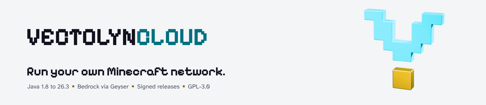

<h1 align="center">
  <picture>
    <source media="(prefers-color-scheme: dark)" srcset="branding/png/readme-header-dark@2x.png">
    
  </picture>
</h1>

<p align="center"><strong>Run your own Minecraft network.</strong></p>

[](https://github.com/VectoDE/VectolynCloud/actions/workflows/ci.yml)
[](https://github.com/VectoDE/VectolynCloud/actions/workflows/codeql.yml)
[](https://scorecard.dev/viewer/?uri=github.com/VectoDE/VectolynCloud)
[](https://www.bestpractices.dev/projects/16026)
[](LICENSE)

**English** · [Deutsch](README.de.md)

Vectolyn is an open-source kit (GPL-3.0) for running your own Minecraft network, on which Java players (1.8 to 26.3) and Bedrock players play together.

We do not run a network ourselves: there is no official server, domain, hosted website, Discord bot or store. The website, Discord bot and store are code in this repository. You configure them with your own bot token and your own Stripe account and host them yourself.

The long-term goal: you run `java -jar VectolynCloud.jar` on Windows, Linux, macOS, in Docker or on Pterodactyl, answer a setup wizard, and the complete network comes up with database, proxy, lobby, game modes and minigames. A release will contain `VectolynCloud.jar`, start scripts for Windows, Linux and macOS, and a Docker image on GHCR, all signed and with provenance. Plugin jars are not attached to releases. The Dockerfile, the compose file and the Pterodactyl egg live in this repository.

## Status

**Stage 2 of 8: VectolynCloud core.** Stage 1, the foundation, is finished and out as the signed pre-release [v0.1.1-dev](https://github.com/VectoDE/VectolynCloud/releases/tag/v0.1.1-dev). Stage 2 builds the cloud module by module; the task list is in [#11](https://github.com/VectoDE/VectolynCloud/issues/11), the overall plan on the roadmap. There is no usable cloud release yet; v0.1.1-dev is an early pre-release. Much of the *Architecture* section is still the plan, not working code.

- Roadmap and progress: [Vectolyn Roadmap](https://github.com/users/VectoDE/projects/11)
- Current stage: [#11 Stage 2: VectolynCloud core](https://github.com/VectoDE/VectolynCloud/issues/11)

| Stage | Content |
|---|---|
| 1 | Foundation: repository, build, config fixes |
| 2 | VectolynCloud core |
| 3 | Vectolyn plugin base: core, permissions, messaging, portals/End, sync, version adapters |
| 4 | Lobby |
| 5 | Survival, Creative, Mod server |
| 6 | Minigames and anti-cheat |
| 7 | Brand and resource pack |
| 8 | Dashboard, Discord bot, website, store |

## Architecture

```
 Java 1.8 to 26.3         Bedrock
        │                    │
        ▼                    ▼
 ┌──────────────────────────────────────┐
 │ Proxy: Velocity                      │
 │ ViaVersion/ViaBackwards/ViaRewind    │
 │ Geyser + Floodgate                   │
 └──────────────────┬───────────────────┘
                    │ modern forwarding
   ┌────────┬───────┼─────────┬─────────┬───────────┐
   ▼        ▼       ▼         ▼         ▼           ▼
 Lobby  Survival Creative  Mod (Fabric) End    Minigames (planned)
   └────────┴───────┴─────────┴─────────┴───────────┘
                    │
                MariaDB

 VectolynCloud (planned) starts, scales and watches all of the above.
```

- **Proxy:** Velocity is the single entry point. Geyser and Floodgate let Bedrock clients in, the Via plugins translate older Java versions. Backends run the newest Minecraft version.
- **Backends:** Paper for Lobby, Survival, Creative, End and (later) Minigames. Fabric for the mod server.
- **No command blocks:** they are off on every server and cannot be switched back on; the Paper and 1.8.8 bridges also remove them from the worlds. Staff commands only work for the console and players with the permission; the [rights audit](docs/cloud/rights-audit.md) lists every one.
- **VectolynCloud** (planned, stage 2): a Java node with console and setup wizard. It downloads and verifies server software, manages JREs and the database, generates secrets, scales minigame servers and offers a REST/WebSocket API. Setup works like CloudNet: a console wizard on first start, then config files and console commands (stage 2). The web dashboard will cover everything as well, first-time setup included (stage 8). In the wizard, the config or later the dashboard you mark each of the seven servers and each minigame group as wanted or not. The cloud only builds wanted servers: it copies the server's template (`templates/<Server>/` in this repository) to `runtime/`, downloads the software, fills in the secrets and starts them. Servers you do not want are never created, and neither the proxy nor the lobby refers to them.
- **One Vectolyn plugin** (planned, stage 3): several Gradle modules (core, permissions, social, moderation, stats, economy, lobby, portals and more) bundled into one jar per platform: `Vectolyn-Paper.jar`, `Vectolyn-Velocity.jar`, `Vectolyn-Fabric.jar`. It will replace LuckPerms, TAB, WorldEdit, WorldGuard, PlaceholderAPI, ProxyPortal and Chunky.

Third-party software is limited to a necessary base: Paper, Velocity, Fabric and Fabric API, Geyser, Floodgate, ViaVersion, ViaBackwards, ViaRewind, the performance mods Lithium, FerriteCore, ServerCore and FabricProxy-Lite, and MariaDB/MySQL.

More detail: [Architecture in the wiki](https://github.com/VectoDE/VectolynCloud/wiki/Architecture).

## Repository layout

```
VectolynCloud/
  cloud/                  VectolynCloud, one Gradle module per part: launcher, node, config, api,
                          console, setup, database, download, template, network, backup, monitor,
                          cluster
    dist/                 start scripts, Docker, Pterodactyl egg, systemd unit, vectolyn.env.example
  common/
    protocol/             wire format of the cloud channel
    client/               client the plugins use to talk to the cloud
  plugins/<feature>/<platform>/
                          one module and one jar per feature and platform
    bridge/               cloud bridge: common, paper, legacy, velocity
    lobby/paper/          lobby
    portal/paper/         portals and End
  templates/<Server>/     server configs with placeholders, tracked in git
  services/               dashboard, website, Discord bot, store (planned)
  resourcepack/           Vectolyn resource pack (planned)
  docs/                   project docs; docs/wiki/ is mirrored into the GitHub wiki
  build-logic/, gradle/   Gradle conventions, version catalog, dependency verification
  .github/                workflows, issue forms, Dependabot
```

Server runtimes (jars, worlds, logs) and secrets are not part of the repository. They live in the cloud home, the folder VectolynCloud runs in: `config/` holds the configuration, `local/` the templates and the worlds of the static services, `storage/` the downloads, `secrets/` the secrets (layout: [architecture](docs/cloud/architecture.md#cloud-home)). For local development that is `run/` in the repository root (see [Run locally](#run-locally)); `.gitignore` keeps the whole folder out of Git.

## Quick start (transitional, until VectolynCloud exists)

Until stage 2 the servers run on Windows from a network folder outside the repository (for example `C:\Vectolyn`, the later cloud home) through start scripts. Picking which servers you want only becomes possible with VectolynCloud; today's launcher starts all of them. You need Java 25 on the `PATH` (Paper 26.3 requires it) and the portable MariaDB 11.8.9 for Windows.

1. Clone the repository.
2. Copy each `templates/<Server>/` to `<network folder>\<Server>\runtime\`.
3. Copy `cloud/dist/secrets/vectolyn.env.example` to `<network folder>\secrets\vectolyn.env` and fill in your own values. Never commit this file.
4. Replace every `{{VECTOLYN_…}}` placeholder in the `runtime/` folders with your values and create the generated files (`forwarding.secret`, Floodgate `key.pem`, `eula.txt`). [`templates/placeholders.md`](templates/placeholders.md) lists every placeholder. VectolynCloud will do this step for you.
5. Put the server software into each `runtime/` folder. The repository ships no jars. The start scripts expect `velocity.jar`, `paper.jar` and `fabric-server.jar`; exact versions and plugin files are listed in [Getting Started](docs/wiki/Getting-Started.md).
6. Copy `start-network.bat` and `start-vectolyn-database.cmd` from `cloud/dist/manual/` into the network folder, run `start-network.bat` there and choose:
   - `1` everything: database, then proxy and all five backends
   - `2` database only (same as `start-vectolyn-database.cmd`)
   - `3` proxy only
   - `4` backends only (Lobby, Survival, Mod, Creative, End)
   - `5` quit

Default ports of the current setup:

| Service | Port |
|---|---|
| Proxy, Java | 25565 |
| Proxy, Bedrock (Geyser: RakNet UDP, NetherNet signaling TCP) | 19132 |
| Proxy, Bedrock NetherNet (Geyser, UDP, always Bedrock + 1) | 19133 |
| Lobby | 25566 |
| Survival | 25567 |
| Mod server | 25568 |
| Creative | 25569 |
| End | 25570 |
| MariaDB | 3307 |

Only the proxy ports should be reachable from outside.

## Build

```sh
./gradlew build
```

On Windows use `gradlew.bat build`. The Gradle wrapper downloads Gradle itself. Every dependency is checked against a SHA-256 checksum, see [docs/dependency-verification.md](docs/dependency-verification.md).

- Gradle starts on Java 17 or newer and compiles with a Java 25 toolchain. If no JDK 25 is installed, Gradle downloads one (Foojay resolver).
- The bytecode target is Java 21 (`--release 21`). The servers themselves need Java 25, because Paper 26.3 does.
- CI builds and runs all tests with JDK 25 on Linux and Windows, and runs the tests a second time on a Java 21 runtime. Tests that load Paper classes are skipped there; see [docs/java-compatibility.md](docs/java-compatibility.md).
- Code that needs Java 25 gets `@RequiresJava25` and keeps a Java 21 path.

## Run locally

```sh
./gradlew :cloud:node:runLocal
```

This builds `VectolynCloud.jar` and starts it with `run/` in the repository root as the cloud home. The folder is created on the first start. The setup assistant asks its questions in the same terminal, then the cloud downloads the server software and starts the network. Configuration, secrets, worlds, logs and downloads all stay in `run/`, which Git ignores as a whole. Delete the folder to start over.

Gradle gives the cloud no real terminal, so the console reads plain lines without editing or completion, and secrets you type into the setup assistant stay visible. Add `--console=plain` so Gradle's progress line does not get in the way. Stop the network with `shutdown` in the console; Ctrl+C cancels Gradle, and on Windows that ends the cloud without a clean shutdown. Details: [docs/cloud/launcher.md](docs/cloud/launcher.md#local-start-from-the-repository).

The launcher refuses to run as root or administrator. If your development shell runs elevated anyway, add `-PallowRoot=true` (passes `--allow-root`).

`run/` is for development and testing only. Production servers get their own cloud home outside any checkout, see [docs/cloud/operations.md](docs/cloud/operations.md).

## Documentation and community

- [Project page](https://vectode.github.io/VectolynCloud/) with the [brand guide](https://vectode.github.io/VectolynCloud/brand/) (sources in `site/` and `branding/`)
- [Wiki](https://github.com/VectoDE/VectolynCloud/wiki) (English and German, sources in `docs/wiki/`)
- [Discussions](https://github.com/VectoDE/VectolynCloud/discussions) for questions, ideas and announcements
- [Contributing](CONTRIBUTING.md) · [Code of Conduct](CODE_OF_CONDUCT.md) · [Security](SECURITY.md)

## License

[GPL-3.0](LICENSE). Minecraft is a trademark of Mojang Synergies AB. Vectolyn is not affiliated with Mojang or Microsoft.
