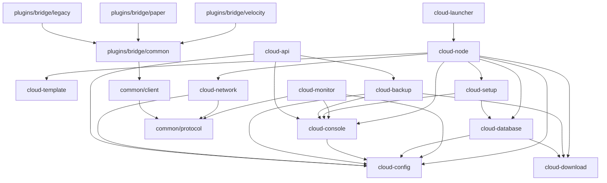

# VectoraCloud architecture

VectoraCloud is the Java application behind `java -jar VectoraCloud.jar`. It renders the server templates of its home (`<home>/local/templates/<Server>/default/`, written from the copies of `templates/` it carries, only for wanted servers), downloads and verifies the server software, sets up the database, starts and watches every proxy and server, and offers a console and an [API](api.md).

This page describes the module layout. Each module gets its content in its own pull request (see the [roadmap](../wiki/Roadmap.md)). Done so far: [protocol](protocol.md), [configuration](config.md), [templates](template.md), [downloads](download.md), the [launcher](launcher.md), the [cloud channel](network.md) (`cloud/network` and `common/client`), the [database](database.md), the [node's service core](node.md), the [console](console.md), the [bridges](bridges.md), [backups](backup.md), [operations](operations.md) (start scripts, systemd, Docker, Pterodactyl, release files), [monitoring](monitor.md), the [API](api.md) and the [autoscaling](scaling.md), all wired into the node. The other modules are still empty shells with their final dependencies.

## Modules

| Module | Package | Purpose |
|---|---|---|
| `common/protocol` | `net.vectora.protocol` | Wire format of the cloud channel. No dependencies at all, because it runs inside every proxy and server. See [protocol.md](protocol.md). |
| `common/client` | `net.vectora.cloud.client` | Client side of the channel, used by the bridges and later by the Vectora plugin. Uses only the JDK for networking (no Netty, neither shaded nor the server's), reasons in [network.md](network.md#why-the-client-uses-plain-jdk-sockets-and-no-netty). |
| `cloud/config` | `net.vectora.cloud.config` | Configuration model: `config/cloud.yml`, `config/groups/`, `config/tasks/`, `config/nodes.yml`, each with a `schema-version`, plus `secrets/vectora.env`. The API speaks JSON with the same model. See [config.md](config.md). |
| `cloud/template` | `net.vectora.cloud.template` | Turns `<home>/local/templates/<Server>/default/` (from `templates/<Server>/`) into the service folder: placeholders, secrets, wanted and unwanted servers. See [template.md](template.md). |
| `cloud/download` | `net.vectora.cloud.download` | Downloads server software, plugins, mods and JREs over HTTPS from an allowlist of hosts, verifies checksums, guards against zip slip. Owns `config/software.lock.yml`, the record of every resolved artifact with its hash. Its `jre` package picks and installs the Java runtime per group; `cloud/node` calls `JreManager`. See [download.md](download.md). |
| `cloud/console` | `net.vectora.cloud.console` | Console: JLine terminal or plain stdin, command registry and parser, built-in commands (`help`, `shutdown`, `config`, `group`, `task`), question API for the setup assistant. See [console.md](console.md). |
| `cloud/network` | `net.vectora.cloud.network` | Netty server for the cloud channel (bridges, later nodes). Loopback by default, per-start service tokens, connection limits. See [network.md](network.md). |
| `cloud/api` | `net.vectora.cloud.api` | REST and WebSocket API on Netty: tokens with scopes (SHA-256 only), rate limits, TLS outside loopback, strict JSON, live events; writes go through `ConfigService.apply`. The node plugs in through `ApiBackend`. See [api.md](api.md). |
| `cloud/database` | `net.vectora.cloud.database` | Database setup (managed MariaDB, Docker, external server or H2) and central sizing of the connection pools. See [database](database.md). |
| `cloud/monitor` | `net.vectora.cloud.monitor` | Metrics per service and node, history, alert rules with hysteresis and debounce, webhook notifications, `monitor` and `alerts` commands, optional Prometheus endpoint on loopback. See [monitor.md](monitor.md). |
| `cloud/setup` | `net.vectora.cloud.setup` | Setup assistant: the questions on the console, the setup file for `--non-interactive`, the `setup` command. Writes through `ConfigService`. See [setup](setup.md). |
| `cloud/backup` | `net.vectora.cloud.backup` | Backups of the static services (worlds and configs, consistent through `save-off`/`save-all flush`/`save-on`) and of the database as zip archives in `backups/`, with manifest and SHA-256 per file, retention, schedule, restore of a stopped service and the `backup` console command. `cloud/node` provides the services and their control. See [backup.md](backup.md). |
| `cloud/node` | `net.vectora.cloud.node` | The node itself: services, groups and tasks, JRE management, console, setup flow, scaling, monitoring, backups, updates, cluster. See [node.md](node.md). |
| `cloud/launcher` | `net.vectora.cloud.launcher` | Entry point of `VectoraCloud.jar`: arguments, refusal to run as root or administrator (unless `--allow-root` or `VECTORA_ALLOW_ROOT=true`), node startup. See [launcher.md](launcher.md). |
| `plugins/bridge/common` | `net.vectora.cloud.bridge` | Platform-neutral core of the bridges: send queue on a thread of its own, server registry and player state of the proxy, tick meter, the BungeeGuard check for the 1.8.8 backends. No platform API, runs and is tested on Java 21. See [bridges.md](bridges.md). |
| `plugins/bridge/velocity` | `net.vectora.cloud.bridge.velocity` | Runs inside Velocity, the main proxy and the legacy proxy: dynamic servers, player events, status. Compiles against `velocity-api` (compile only). |
| `plugins/bridge/paper` | `net.vectora.cloud.bridge.paper` | Runs inside Paper: ready signal and status. Compiles against `paper-api` (compile only). |
| `plugins/bridge/legacy` | `net.vectora.cloud.bridge.legacy` | Runs inside PandaSpigot 1.8.8: the same plus the check of the legacy proxy's `bungeeguard-token`. Compiles against `pandaspigot-api` (compile only, Java 8 class files). |

From stage 3 on, the Vectora plugin takes over status and messaging from the bridges. It uses `common/client` as well.

The 1.8.8 groups behind the legacy proxy are described in [Legacy 1.8.8 groups](legacy-1.8.8.md).

## Dependency graph

Arrows point from a module to what it depends on. Only project dependencies are shown; the libraries follow in the next section.



The rules behind it:

- `common/protocol` depends on nothing. The cloud and the clients share it, so neither side can drift from the wire format.
- Code that runs inside a proxy or server (`common/client`, the bridges) never pulls in Netty, Jackson or JLine. The servers ship their own copies of some of these, and a second copy on their class path invites conflicts.
- `cloud/config` sits at the bottom of the cloud modules. Console, files and later the dashboard all go through the same configuration layer.
- `cloud/database` uses `cloud/download` because the managed mode downloads the MariaDB server itself.
- Only `cloud/node` knows all other cloud modules. `cloud/launcher` only knows `cloud/node`.

## Runtime libraries

| Library | Version | Used by | Why |
|---|---|---|---|
| Netty (`netty-transport`, `netty-handler`, `netty-codec-http`) | 4.2.19.Final | `cloud/network`, `cloud/api` | Non-blocking server for many long-lived connections (every proxy and server keeps one open), TLS 1.3 for the mTLS cluster links, and HTTP plus WebSocket for the API from the same stack. Velocity and Paper are built on Netty too, so its behaviour under load is well known. |
| JLine 3 (`jline-reader`, `jline-terminal`, `jline-terminal-jni`) | 3.30.17 | `cloud/console` | Console with line editing, history and tab completion on Windows, Linux and macOS, as in CloudNet. The terminal provider `jni` works on Java 21. `ffm` (`jline-terminal-ffm`) needs Java 22+ and is chosen only on such runtimes, see [Java compatibility](../java-compatibility.md). |
| Jackson 3 (`jackson-databind`, `jackson-dataformat-yaml`) | 3.2.4 | `cloud/config`, `cloud/download` | One data model for the YAML files and the JSON API, with explicit `schema-version` handling and exact error positions for broken config files. `cloud/download` also reads the download APIs, `software.lock.yml` and its catalog with it. |
| MariaDB Connector/J (`mariadb-java-client`) | 4.0.0 | `cloud/database` | Talks to the managed or external MariaDB/MySQL server: creating databases and users, checking the connection, sizing the pools. |

Test only: JUnit 6 and Jazzer 0.30.0 (fuzz tests, see below). Compile only: `velocity-api` 4.3.1, `paper-api` 26.3 and `pandaspigot-api` 1.8.8 (with `adventure-api` 4.24.0) in the bridges. The proxy and the server provide them at runtime.

Versions live in `gradle/libs.versions.toml`. Dependabot proposes updates.

## No wrapper jar

CloudNet and similar clouds start each server through an extra wrapper jar that sits between the JVM and the server. VectoraCloud does not. The node starts the server JVM directly with `ProcessBuilder` (the matching JRE, the server jar, the generated arguments) and reads its output.

The reasons:

- One process less per server, and no class-loader tricks around the server's own startup.
- The server runs exactly as its own documentation describes, so a problem can be reproduced without the cloud.
- What a wrapper would do happens elsewhere. Process state, exit codes and logs come from the process handle. Status and messaging come from the bridges (stage 2) and the Vectora plugin (stage 3) over the cloud channel.

## Java levels

All cloud modules, `common/protocol` and `common/client` are built with `--release 21` and run on Java 21 and newer. The bridges also have bytecode 21, but `velocity-api` 4.3 and `paper-api` 26.3 are compiled for Java 25 (class file version 69). The Velocity and Paper bridges therefore run only where the proxy or server runs, on Java 25. The legacy bridge runs on PandaSpigot's Java 21. Details in [Java compatibility](../java-compatibility.md).

## Build setup

The shared Gradle setup lives in the included build `build-logic/` as convention plugins:

| Plugin | Used by | What it does |
|---|---|---|
| `vectora.java-conventions` | every Java module | Java 25 toolchain, `--release 21`, `-Xlint:all -Werror` (a module may switch `-Werror` off and has to say why), JUnit, `-PtestJava=21`, reproducible jars. |
| `vectora.java25-api-conventions` | Velocity and Paper bridges, `plugins/lobby/paper`, `plugins/portal/paper` | Everything above, plus `disableAutoTargetJvm()` for the Java 25 server APIs. |
| `vectora.fuzz-conventions` | modules with fuzz tests (`common/protocol`, `common/client`, `cloud/config`, `cloud/template`, `cloud/download`, `cloud/network`, `cloud/database`, `cloud/node`, `cloud/console`, `cloud/setup`, `cloud/backup`, `plugins/bridge/common`, `cloud/monitor`, `cloud/api`) | Adds Jazzer, runs `@FuzzTest` methods in regression mode in every test run; `-Pfuzz` switches to fuzzing mode. |

## Fuzz tests

Code that parses untrusted input (protocol frames, config files, downloaded archives, API requests) gets Jazzer fuzz tests next to its unit tests.

- **Regression mode, in every test run:** each `@FuzzTest` runs once per stored input in `src/test/resources/<package>/<TestClass>Inputs/<method>/`, plus an empty input. This is a normal JUnit test. It runs on Linux and Windows, on Java 21 and 25 (checked with Jazzer 0.30.0 and `VarIntsFuzzTest`).
- **Fuzzing mode, nightly:** `.github/workflows/fuzz-nightly.yml` finds every `@FuzzTest` method and fuzzes each one for a fixed time on Linux with Java 21. A crash fails the job and is uploaded as an artifact. The input then goes into the inputs directory above, together with the fix.
- **Locally:** `./gradlew :common:protocol:test --tests 'net.vectora.protocol.VarIntsFuzzTest.readFailsOnlyWithProtocolException' -Pfuzz -PfuzzMaxDuration=1m`. Always select one method, because Jazzer fuzzes only the first fuzz test it meets per run. The generated corpus goes to `.cifuzz-corpus/`, which git ignores.

## Cloud home

The cloud keeps its data in files, not in a database. The home is the folder the cloud runs in (`VECTORA_HOME`, by default the folder of the start script), never a folder of the repository. The repository only holds the templates (`templates/`) and example files (`cloud/dist/`).

```
<home>/
  VectoraCloud.jar
  config/            cloud.yml, nodes.yml, monitor.yml, backup.yml, software.lock.yml
                     (+ <file>.v<N>.bak after a schema migration)
    groups/          <group>.yml
    tasks/           <task>.yml
  local/
    templates/<template>/default/   only for wanted servers (<template> = `template` of the group)
    services/<service-id>/          static services, kept (local/services/lobby-1)
  temp/
    services/<service-id>_<run>/    dynamic services, deleted on stop
    backup/                         work folder of the backups
  database/          managed MariaDB: binaries, data, vectora-mariadb.ini, mariadb.log
                     (docker mode: compose.database.yml)
  storage/           artifacts/ (download cache), jre/ (managed JREs),
                     libs/<version>/ (libraries of VectoraCloud.jar, unpacked by the launcher)
  secrets/           vectora.env, api-tokens.json, TLS password; owner only
  backups/           default target of backup.yml
  logs/              cloud.log (+ cloud.1.log to cloud.5.log), services/<id>.log
  state/             cloud.lock, services.json, console.history, monitor-history.bin, home-layout
```

What is configuration is in `config/`, what is data you would back up is in `local/` and `database/`, what the cloud can fetch or rebuild is in `storage/` and `temp/`. Configuration file names in error messages, events, the API and the console are relative to `config/` (`groups/lobby.yml`), so they read the same everywhere. Homes from before this layout are moved on the first start, see [home layout migration](node.md#home-layout-migration).
