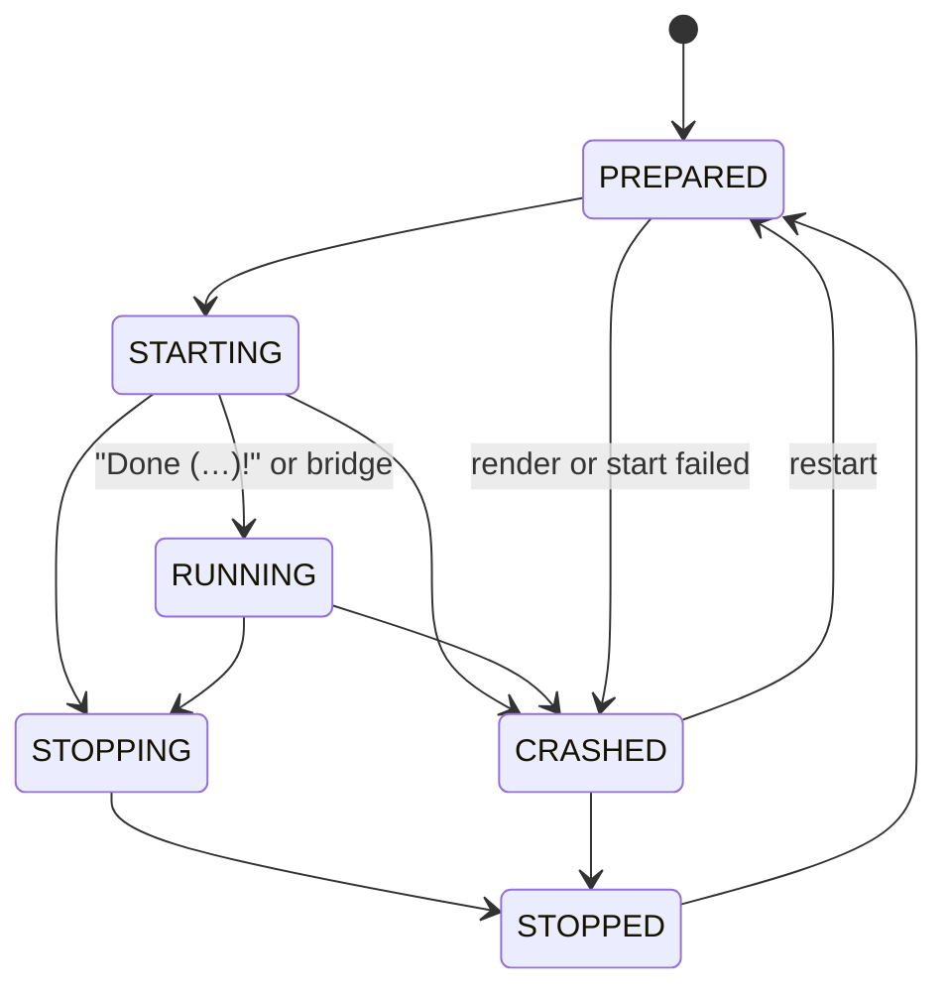

# VectoraCloud node: service core

`VectoraCloud/cloud-node` (package `net.vectora.cloud.node`) is the node itself. This page covers the entry point the launcher calls, how the node puts its parts together (home lock, Java runtimes, database, cloud channel, console) and the service core, which renders the wanted servers, starts them as plain Java processes, watches them, restarts them after a crash and stops them in stages. Setup assistant, scaling, software downloads and the bridges come in later pull requests; the interfaces they plug into are listed at the end.

## Start order

`NodeMain.start(Map<String, String>)` is called by the launcher (settings in [launcher.md](launcher.md#node-entry-point)). It:

1. checks the settings (`NodeSettings.parse`: `home` absolute, `language` `de` or `en`, booleans `true` or `false`);
2. takes the [home lock](#home-lock) and removes what an interrupted run left behind: unfinished downloads (`cache/artifacts/download-*.part`, `ArtifactCache.removeStalePartFiles`) and unfinished Java installs (`jre/.staging-*`, `jre/.old-*`, `JreInstaller.removeLeftovers`);
3. opens the configuration (`ConfigService`) and generates missing secrets in `secrets/vectora.env`;
4. builds the parts (`CloudNode.open`) and registers the shutdown hook `vectora-shutdown` before anything starts, so a `SIGTERM` or Ctrl+C while the database is set up or the servers start still stops what has been started: the service core with the [Java runtimes](#java-runtimes) and the [database](#database) as start gate and placeholder source, the [cloud channel](network.md) server with the tokens of the service core, and the [console](console.md);
5. starts watching the configuration files and reconciles on every change (see [Reload](#reload));
6. starts the cloud channel on host and port of this node in `nodes.yml`; services get the bound address in `VECTORA_CLOUD_HOST` and `VECTORA_CLOUD_PORT`;
7. starts the console: log records go through it with the secret filter (`logHandler(RedactingFilter::redact)`), the built-in commands get the real shutdown, and the [`service` commands](#console-commands) are added;
8. ends orphaned servers from the previous run (see [Orphans](#orphans));
9. starts every planned service, but only if `cloud.yml` has `setup-complete: true` and `eula-accepted: true`. Otherwise it logs a warning and starts nothing. The same gate applies to every later start, also `service start` in the console;
10. keeps the JVM alive with the non-daemon thread `vectora-node`.

A second `start` in the same JVM is an error.

`CloudNode.close()` (the shutdown hook, `shutdown` in the console, a second Ctrl+C) runs the reverse order: console, services (each with its stop command), database (`DatabaseProvisioner.shutdown()` after the last service), cloud channel, configuration, log handlers, home lock. It is idempotent; a second caller waits until the first has finished. Once it has begun, no start reaches the database any more, so a start that was still running cannot leave a MariaDB behind. `SIGTERM` (`docker stop`, systemd) and Ctrl+C in plain mode reach the JVM's shutdown hook and end the node the same way.

## Home lock

Only one cloud may use a home. The node holds an exclusive lock on `state/cloud.lock` (`FileChannel.tryLock`) for as long as it runs. A second cloud on the same home, in this or another process, stops at the start with `HomeLock.HomeLockedException`: "Another VectoraCloud already runs with the home … (it holds state/cloud.lock)". The operating system releases the lock when the process ends, also after a crash or `kill -9`, so a stale file never blocks a start. The cleanup of download and install leftovers relies on the lock: no other process can be writing them.

## Java runtimes

`ManagedJavaRuntimes` is the node's `JavaRuntimeResolver`. For each start it builds the group's `JavaRequirement` and asks `JreManager` (see [download.md](download.md)) for a runtime:

- PandaSpigot (the 1.8.8 groups) gets Java 21, every other software Java 25.
- `java: <major>` in the group file overrides that. An override below the minimum of the server software fails the start with a message that names both versions.
- The minimum is the highest known one (`JavaRequirement.minimumOf`): Mojang's `javaVersion`, Fill's `java.version.minimum`. They come from the software downloads (PR 14); until then none is known.
- A system Java of exactly that version is used if there is one; otherwise a Temurin JRE is downloaded into `<home>/jre/` and pinned in `software.lock.yml`, the same `SoftwareLockStore.inHome(home)` the other downloads use.

The JRE manager is built on the first start that needs it.

## Database

`NodeDatabase` connects the [database module](database.md) to the service core:

- As `ServiceManager.StartGate` it calls `DatabaseProvisioner.provision()` before the first service starts, once per run. A failed attempt refuses that start with the reason and is repeated at the next start. The provisioner's `notice()` (for example that `max_connections` could not be read) is logged as a warning.
- As `PlaceholderContributor` it adds `VECTORA_DB_HOST`, `_PORT`, `_NAME`, `_USER`, `VECTORA_DB_STORAGE_METHOD` and `VECTORA_DB_POOL_SIZE`. The pool size comes from the provisioner's `ConnectionBudget`, shared by all services that may run on this node at once (the sum of `max-services` of the wanted tasks). If even pools of 2 do not fit, the start is refused with the budget's explanation instead of servers that fail later with "Too many connections".
- `shutdown()` runs after the last service has stopped. After it, `beforeStart()` refuses.
- Only a wanted database server runs: with `servers.database: false` in `cloud.yml`, the mode `managed` starts no MariaDB and uses the embedded H2 store instead, with a warning. The modes `docker` and `external` start no server of the cloud's own, and `h2` starts nothing.
- `NodeDatabaseProcesses` runs MariaDB's programs for the managed mode: absolute program path, no shell, output appended to the log file, the node's environment without `VECTORA_*`, and a program that does not finish in time is killed with its children.

`database.mode` is read when the database is first set up; a change takes effect at the next start of the cloud.

## Which services run

A service is one running server process. The plan comes from the configuration:

- Each task in `tasks/` that runs on this node (`nodes` empty or containing `node-id`) gets `min-services` services of its group.
- A group whose `template` is one of the eight known folders (`Proxy`, `Lobby-Server`, `Survival-Server`, `Creative-Server`, `Mod-Server`, `End-Server`, `Database`, `Minigame-Server`) follows the `servers` switches in `cloud.yml`. An unwanted group is neither rendered nor started, and the proxy does not list it.
- `Database` is never a service; the [database module](database.md) runs it.
- The 1.8.8 groups (a group on the `Legacy-Proxy` template and every PandaSpigot group) are only wanted while `legacy-proxy.enabled` is `true`.
- A group on its own template folder counts as wanted.
- `max-services` caps the services per task, also for manual starts.

Backends start before proxies, so the proxy's server list is complete when it renders.

## Ids, folders and ports

| | Rule |
|---|---|
| Service id | `<group>-<index>`, index 1 to 9999, the lowest free index of the group. Example: `lobby-1`. |
| Folder, static task | index 1: `<home>/<template>/runtime`, index n: `<home>/<template>/runtime-<n>`. Kept after the stop: worlds and player data stay. |
| Folder, dynamic task | `<home>/temp/services/<id>`. Cleared before the start and deleted after the stop. Only direct children of `temp/services` are deleted, and links are not followed. While the folder of a stopped service is still being deleted (on Windows a locked file can delay this by a few seconds), its id is not handed out again; the next start takes the next free index. |
| Port, proxy | `cloud.proxy.port` (the software `velocity` marks a proxy); the proxy on the `Legacy-Proxy` template gets `legacy-proxy.port`. One proxy of each kind per node. |
| Port, other services | the first free port in the node's `service-ports`, skipping the node's fixed ports (proxy, Bedrock, legacy proxy, API, database, channel) and ports another program already has bound. Never two services on one port. |

Every start renders the template with [cloud-template](template.md) into the folder. Besides the secrets, the node provides `VECTORA_SERVER_HOST`, `VECTORA_SERVER_PORT`, `VECTORA_XMS`, `VECTORA_XMX`, `VECTORA_DB_HOST`, `VECTORA_DB_PORT`, `VECTORA_DB_NAME`, `VECTORA_DB_USER` and, for the proxy, `VECTORA_PROXY_BIND`, `VECTORA_PROXY_PORT`, `VECTORA_BEDROCK_PORT` and the server list. In the proxy list a static backend with index 1 appears under its group name (`lobby`), every other one under its id (`lobby-2`). The try list holds the lobby backends. The main proxy lists every backend except PandaSpigot; the legacy proxy lists only the PandaSpigot backends, all of them in its try list, and gets `VECTORA_LEGACY_PROXY_PORT`. Dynamic services are not written into `velocity.toml`; they register through the bridge (PR 13).

## Process

The node starts the server JVM directly with `ProcessBuilder`, without a wrapper jar (see [architecture](architecture.md#no-wrapper-jar)):

```
<java> -Xms<heap.min> -Xmx<heap.max> <process.jvm-flags> [-Dstdout.encoding=UTF-8 -Dstderr.encoding=UTF-8] -jar <software jar> [--nogui]
```

- `<java>` comes from the `JavaRuntimeResolver`, in the running node `ManagedJavaRuntimes` (see [Java runtimes](#java-runtimes)).
- The template is installed for its platform: `Legacy-Proxy` with Velocity as `VELOCITY_LEGACY`, so its `forwarding.secret` holds `VECTORA_LEGACY_FORWARDING_SECRET`; PandaSpigot as `PANDASPIGOT`; the others by their software.
- The encoding flags are added from Java 18 on. `--nogui` is added for everything except Velocity.
- No shell is involved; flags are single arguments. Flags that would change heap, class path or the main jar (`-Xms…`, `-Xmx…`, `-jar`, `-cp`, `-XX:Flags=`, `-XX:VMOptionsFile=`, `-version`, `-help`, …) are rejected by the validator.
- The environment is the node's own without any `VECTORA_*` variable, plus the variables below. Their names are constants of `net.vectora.protocol.ServiceEnvironment`, which `CloudClientSettings` reads as well, so node and bridges cannot drift apart.

| Variable | Value |
|---|---|
| `VECTORA_SERVICE_ID` | service id |
| `VECTORA_SERVICE_GROUP`, `VECTORA_SERVICE_TASK` | group and task name |
| `VECTORA_SERVICE_PORT` | the service's port |
| `VECTORA_SERVICE_TOKEN` | a new random token per start (`ServiceTokens.issue`, 32 bytes, base64url). The bridge logs in to the cloud channel with it; the channel checks it in constant time through `ServiceManager.authenticator()`. The service core is the only place that issues and revokes tokens: revoked when the process ends and when the start fails, and a restart issues a new one. |
| `VECTORA_CLOUD_HOST`, `VECTORA_CLOUD_PORT` | where this node's channel listens, as bound. A wildcard bind (`0.0.0.0`, `::`) is passed as `127.0.0.1` or `::1`. |

## Life cycle



- **RUNNING** is reached when the output contains a line with `Done (` and `)!` (Paper, Fabric and Velocity print it) or when the bridge sends `ServiceReady` on the cloud channel (`CloudClient.markReady()`; `ChannelBridge` calls `ServiceManager.markReady`).
- **Stop while PREPARED** (template being rendered, software being downloaded): the service ends in STOPPED right away and no process is started.
- **The channel follows the life cycle:** when a process ends (STOPPED, CRASHED) its token is revoked and `ChannelBridge` closes its connection with `SHUTDOWN`. The last `ServiceStatus` of each service is kept for `service list` and `service info`.
- **Stop** goes in stages: the stop command on standard input (`stop`, for Velocity `shutdown`, or `process.stop-command`), then up to `process.stop-timeout` (default 60 s), then a normal termination request, 10 s later the forced end of the process and its children. On Windows the termination request already ends the process.
- **Exit:** a requested stop or exit code 0 ends in STOPPED, anything else in CRASHED.
- **Restart after a crash** (`process.restart`): with `on-crash: true` the service is prepared and started again after `backoff`, doubled for each further crash and capped at `max-backoff`. After `max-attempts` crashes in a row it stays CRASHED. A service that ran for 5 minutes starts counting from zero again.

Listeners (`node.service.ServiceListener`; the cloud channel's listener is `ChannelListener`) get every state change and every output line and implement both methods (an empty body is fine). State changes arrive in order on one shared thread; output lines arrive in order on the output thread of each service.

## Configuration

Each group can have a `process` section; all of it is optional. Details in [config.md](config.md#groupsnameyml).

```yaml
process:
  jvm-flags: [-XX:+UseG1GC]
  stop-command: stop
  stop-timeout: 60s
  restart:
    on-crash: true
    max-attempts: 5
    backoff: 5s
    max-backoff: 300s
```

## Reload

When a configuration file changes, the node calls `ServiceManager.stopUnwanted()`: services whose group is now unwanted (`servers` switch off, `legacy-proxy.enabled` off) are stopped cleanly with their stop command, in the background, and are not planned again. New or changed tasks are not started automatically yet (scaling, PR 15); `service start <task>` starts one.

## Console commands

The node registers `service` (alias `services`) in the console, next to the [built-in commands](console.md):

| Command | Does |
|---|---|
| `service list` | every service with state, port, pid and players (from the last status report) |
| `service info <id>` | all details of one service, with its last status report |
| `service start <task>` | starts one more service of a task (same gate and limits as every start) |
| `service stop <id>` | stops a service and waits until it has ended |
| `service restart <id>` | stops it and starts it again |
| `service command <id> <line>` (alias `cmd`) | types a line into the server's console |
| `service screen <id>` (alias `logs`) | shows the server's output in the console; the same command again hides it |

Lines shown by `screen` have passed the secret filter; control characters and Unicode direction marks are replaced with `?`, so a server cannot send escape sequences to the operator's terminal.

## Logs

The output of each service (standard output and standard error together) goes to `<home>/logs/services/<id>.log`. The previous five runs are kept as `<id>.1.log` to `<id>.5.log`. Every line is passed through the secret filter first: values from `vectora.env` and the service token are written as `***`, in the log and to listeners. Lines longer than 8192 bytes are split, invalid UTF-8 is replaced.

## `state/services.json`

On every state change the node writes all services to `<home>/state/services.json`, atomically (temporary file, flush, rename). Example:

```json
{
  "schema-version" : 1,
  "node" : "node-1",
  "services" : [ {
    "id" : "lobby-1",
    "group" : "lobby",
    "task" : "lobby",
    "index" : 1,
    "mode" : "static",
    "state" : "running",
    "pid" : 4242,
    "started-at" : 1700000000000,
    "port" : 30001,
    "work-directory" : "Lobby-Server/runtime"
  } ]
}
```

The file is read strictly: unknown fields, duplicate keys, an id that is not `<group>-<index>`, negative numbers, ports outside 1 to 65535 and folders that are not plain relative paths are errors. A broken file is moved aside as `services.json.broken-<millis>` and the node starts with an empty state. `ServiceStateStoreFuzzTest` fuzzes the reader.

## Orphans

If the node ends without stopping its services (crash, power loss, `kill -9`), the servers may still run. At the next start the node reads `state/services.json` and, for each service with a pid:

- ends the process if the pid exists and its start time matches the recorded one (within one second): a termination request, then the forced end after the group's `stop-timeout`;
- leaves it alone if the start time differs: the pid now belongs to another program;
- blocks the folder and the port for this run if the start time cannot be read, so no second server opens the same world. The id is reported as unverifiable.

Afterwards the leftover folders in `temp/services/` are deleted, except blocked ones.

## Interfaces for the next pull requests

| Interface | Default in the running node | Who plugs in |
|---|---|---|
| `CloudNode.open(settings, options -> …)` with `CloudNode.Options`: `services()` (the `ServiceManager.Builder`), `network(…)`, `database(…)`, `console(…)`, `noConsole()` | real parts | modules that replace one of them, tests |
| `CloudNode.console()` (`Optional<Console>`; `Console.prompter()` asks questions), `config()`, `secrets()`, `services()`, `database()`, `network()`, `channel()` | | PR 11 (setup assistant), PR 13 |
| `NodeSettings.nonInteractive()`, `setupFile()` | from the launcher | PR 11 |
| `service.JavaRuntimeResolver` | `ManagedJavaRuntimes` on `JreManager` | `ManagedJavaRuntimes.Minimums` gets the Mojang and Fill minimums in PR 14 |
| `service.ServerSoftwareProvider` (`provide(spec, folder)` returns the jar name) | `existingJar()`: the jar must already be in the folder | PR 14, downloads |
| `service.PlaceholderContributor` (extra placeholder values; the node's own values win) | `NodeDatabase` | PR 24 (legacy proxy) |
| `ServiceManager.StartGate` (`beforeStart()`, before every start) | `NodeDatabase` | |
| `ServiceManager.addListener(ServiceListener)` | `ChannelBridge`, `ServiceCommands` | PR 11 (monitoring) |
| `ServiceManager.sendCommand(id, line)` | 1 to 1024 characters, no control characters | |
| `ServiceManager.start(task)`, `stop(id)`, `restart(id)`, `stopUnwanted()`, `services()`, `find(id)` | | PR 15 (scaling) |
| `ServiceManager.authenticator()`, `markReady(id)` | used by the cloud channel | PR 13, bridges |

## Limits today

- Server software is not downloaded yet. Until PR 14, a service only starts if its jar is already in the folder (`paper.jar`, `velocity.jar`, `fabric-server.jar`, `pandaspigot.jar`).
- `service-ports` and `node-id` are read once when the node starts; a change needs a restart.
- One proxy and one legacy proxy per node. PR 24 completes the legacy proxy.
- New tasks and a higher `min-services` after a reload start only with `service start` or the next start of the node (PR 15).
- No scaling: tasks run exactly `min-services` services. PR 15 adds scaling.
