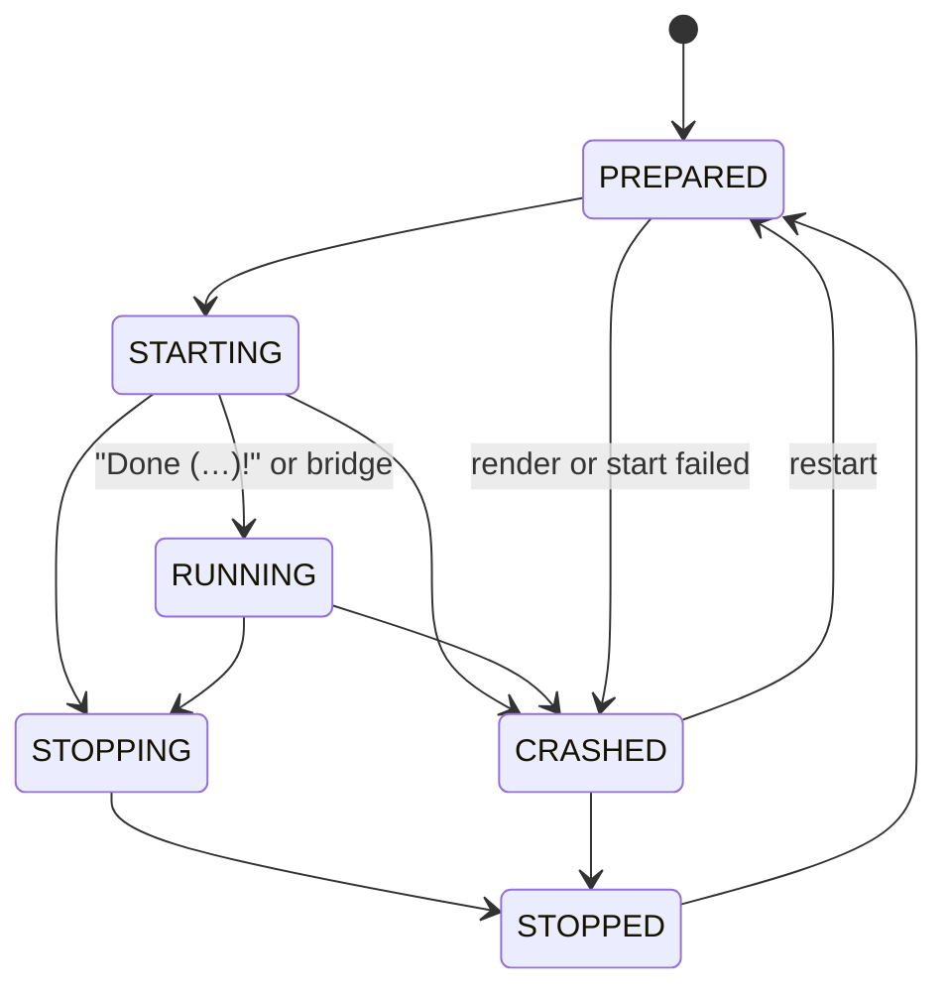

# VectolynCloud node: service core

`cloud/node` (package `net.vectolyn.cloud.node`) is the node itself. This page covers the entry point the launcher calls, how the node puts its parts together (home lock, Java runtimes, database, cloud channel, console) and the service core, which renders the wanted servers, starts them as plain Java processes, watches them, restarts them after a crash and stops them in stages. The [setup assistant](setup.md) runs before the first service starts. Before each start the node downloads the server software and the plugins of the group and copies the bridge jar into the service ([Server software](#server-software)). The [autoscaler](scaling.md) keeps `min-services` of every task running and scales the dynamic services of a group by its load, emptying a service through the proxy before it stops; the interfaces for later pull requests are listed at the end.

## Start order

`NodeMain.start(Map<String, String>)` is called by the launcher (settings in [launcher.md](launcher.md#node-entry-point)). It:

1. checks the settings (`NodeSettings.parse`: `home` absolute, `language` `de` or `en`, booleans `true` or `false`);
2. takes the [home lock](#home-lock), sets up the log handler for the [start output](#start-output) and runs the [home layout migration](#home-layout-migration) (nothing happens in a home that is already on the current layout). Then it removes what an interrupted run left behind: unfinished downloads (`storage/artifacts/download-*.part`, `ArtifactCache.removeStalePartFiles`) and unfinished Java installs (`storage/jre/.staging-*`, `storage/jre/.old-*`, `JreInstaller.removeLeftovers`);
3. opens the configuration (`ConfigService`, files in `config/`) and generates missing secrets in `secrets/vectolyn.env`. A `node-id` in `cloud.yml` that breaks the name rule or is missing from `nodes.yml` fails the start with that error, and the home lock is released;
4. builds the parts (`CloudNode.open`) and registers the shutdown hook `vectolyn-shutdown` before anything starts, so a `SIGTERM` or Ctrl+C while the database is set up or the servers start still stops what has been started: the service core with the [Java runtimes](#java-runtimes) and the [database](#database) as start gate and placeholder source, the [cloud channel](network.md) server with the tokens of the service core, and the [console](console.md);
5. writes the [built-in templates](#built-in-templates) of the wanted servers that the home does not have yet (step "Templates" of the [start output](#start-output)), then starts watching the configuration files and reconciles on every change (see [Reload](#reload));
6. starts the cloud channel on host and port of this node in `nodes.yml`; services get the bound address in `VECTOLYN_CLOUD_HOST` and `VECTOLYN_CLOUD_PORT`;
7. starts the [monitoring](monitor.md) (`MonitorRuntime`, opened in step 4 with the node id as origin; an invalid `monitor.yml` fails the start there), then the [cluster](cluster.md): the cluster port on the head, the link to the head on a member, nothing on a node outside a cluster. A `config/cluster.yml` that cannot be read, or a cluster port that cannot be bound, is logged as an error and the node runs on alone;
8. prepares the console: log records go through it with the secret filter (`logHandler(RedactingFilter::redact)`), the built-in commands get the real shutdown, and the [`service` commands](#console-commands), `setup`, `monitor`, `alerts`, `backup`, `api` and `cluster` are added (`api token` works while the API is off). A `secrets/api-tokens.json` that cannot be read does not stop the node: with `api.enabled: false` it is a warning, with the API on an error and the node runs without the API, as with TLS material it cannot use. Each `api token` command then tries the file again and reports the problem until it is repaired or deleted ([api.md](api.md#tokens));
9. ends orphaned servers from the previous run (see [Orphans](#orphans)). Only then does it put right a [backup or restore](backup.md) that a crash interrupted (`recoverInterruptedOperations`), start the backup schedule and, with `api.enabled`, the [API](api.md) server, so neither a backup nor a start or restore through the API touches a folder that a server of the previous run still writes to. An API that cannot be prepared or bound is logged as an error and the node runs without it; after a failed bind (a port in use, for example) both of its event loop groups are shut down, so no `vectolyn-api` thread is left. `NodeRobustnessTest` covers both, and the refused `node-id` of step 3;
10. runs the setup: `SetupWizard.ensureComplete(console, config, SetupEnvironment.of(settings, env))`, also without a console (then only a setup file can answer). The launcher's `setup-file`, `non-interactive` and `platform.*` settings reach `SetupEnvironment` through `NodeSettings.toMap()`. A `SetupException` is printed with `describe(language)`, on the console or, without one, in the log. On `EULA_DECLINED`, `CANCELLED` or any other result that is not ready, no service starts; the console stays open, and once `setup` finishes there, the node starts the planned services right away;
11. starts the console and every planned service, but only if `cloud.yml` has `setup-complete: true` and `eula-accepted: true`. Otherwise it logs a warning and starts nothing; the steps database, software, templates and services then show as `skipped` in the start output. Before the first service starts, the server jar and the plugins or mods of every group that starts services are fetched into `storage/` (step "Software"). The same gate, and the database's start gate, apply to every later start, also `service start` in the console, `service restart`, the automatic restart after a crash and the scaler. Once the planned services have started, the [autoscaler](scaling.md) begins its rounds (after a setup that finishes later, right after its start of the planned services). Both happen once per run: if `eula-accepted` or `setup-complete` is taken back and given again, the running autoscaler brings the services back;
12. keeps the JVM alive with the non-daemon thread `vectolyn-node`.

A second `start` in the same JVM is an error.

`CloudNode.close()` (the shutdown hook, `shutdown` in the console, a second Ctrl+C) runs the reverse order: first the API refuses starts, reloads and backups (`beginShutdown`), then console, backup schedule, the autoscaler (no round starts a server any more), services (each with its stop command), monitoring (after the last service: history file, queued notifications), database (`DatabaseProvisioner.shutdown()` after the last service), cluster (port or link), cloud channel, configuration, log handlers, the API server (event streams get `1001`), home lock. Every step runs in a `try`/`finally` of its own: if one fails (also with an `Error`), it is logged and the next step still runs, so the home lock is always released; an `Error` is rethrown at the end. It is idempotent; a second caller waits until the first has finished. Once it has begun, no start reaches the database any more, so a start that was still running cannot leave a MariaDB behind. `SIGTERM` (`docker stop`, systemd) and Ctrl+C in plain mode reach the JVM's shutdown hook and end the node the same way.

## Start output

The start is shown as a banner and a few lines, not as a stream of log messages. The banner has the ASCII "VectolynCloud" logo, the version, Java version and vendor, operating system and architecture, and the home. Then every step logs one line in the same format (`StartupReport`):

```
10:15:02 INFO  [1/5] Configuration  ok       9 groups, 9 tasks, node node-1
10:15:03 INFO  [2/5] Database       ok       mariadb on 127.0.0.1:3307
10:15:05 INFO  [3/5] Software       ok       lobby: paper 26.3 + 6 plugins; proxy: velocity 26.3 + 5 plugins
10:15:05 INFO  [4/5] Templates      ok       2 written (Lobby-Server, Proxy), 0 present, for 2 wanted server(s)
10:15:06 INFO  [5/5] Services       ok       2 of 2 started
10:15:06 INFO        lobby-1        starting port 30001, static
10:15:06 INFO        proxy-1        starting port 25565, static
```

| Step | What it covers |
|---|---|
| Configuration | `config/` read and checked |
| Database | the [database](database.md) set up |
| Software | server jar and plugins or mods of every group that starts services, fetched into `storage/` ahead of the starts, so a download problem shows here and not as a failed service |
| Templates | the [built-in templates](#built-in-templates) of the wanted servers written to `local/templates/` |
| Services | the planned services started, one line each |

Status is `ok`, `partly` (some groups or services failed), `failed` or `skipped`. While the setup is incomplete (no EULA, `setup-complete: false`) steps 2 to 5 are `skipped` with the reason. If the database fails, steps 3 to 5 are `skipped`: nothing starts without it.

There is one log format everywhere: `HH:mm:ss LEVEL message`, with the level names `ERROR`, `WARN `, `INFO `, `DEBUG` and `TRACE` padded to five characters. They are fixed and do not depend on the system language (no `INFORMATION` or `WARNUNG`). Before the console is up, a handler on standard output prints the lines and encodes them in the console's code page, so umlauts are right on Windows too. Once the console runs, the lines go through it. In addition, `logs/cloud.log` gets every record in UTF-8 with date and milliseconds, the logger name and the full stack traces, secrets redacted. Each start begins a new file; the five before are kept as `cloud.1.log` to `cloud.5.log`.

On Windows the start scripts switch the console to UTF-8 (`chcp 65001`) and start Java with `-Dstdout.encoding=UTF-8 -Dstderr.encoding=UTF-8`. If you start the jar by hand in an old console, set the same.

## Home layout migration

Homes from before the layout change have configuration, templates and server folders next to each other at the top level. The node moves them on its own. The migration (`HomeLayoutMigration`) runs on every start, under the [home lock](#home-lock) and before the configuration is read. In a home that is already migrated it only checks the marker `state/home-layout` (content `2`).

What happens, in this order:

1. **Check.** If a process from `state/services.json` of the previous run is still alive, the start fails and nothing is moved. End the server first, then start again.
2. **Backup.** `backups/home-layout-migration-<UTC yyyyMMdd-HHmmss>/` (owner only) gets a copy of the configuration files, `groups/`, `tasks/`, every `<Server>/template` and `state/services.json`. Worlds, database files and downloads are not copied; they are moved by rename (same file system). `state/home-layout-migration` records the backup, so a resumed run does not make a second one.
3. **Configuration.** `cloud.yml`, `nodes.yml`, `monitor.yml`, `backup.yml`, `software.lock.yml`, `groups/` and `tasks/` move to `config/`. The node then reads the configuration (without validating or writing it) to know which template each group uses.
4. **Templates.** `<Server>/template` becomes `local/templates/<Server>/default`. It is dropped instead if it is byte-identical to the built-in template of a server that is not wanted, and always for the old `Database` template.
5. **Services.** `<Server>/runtime` and `<Server>/runtime-<n>` become `local/services/<group>-<n>`, when exactly one group uses that template. If several groups use it, the folder stays where it is and the log says so.
6. **Database.** `Database/runtime` becomes `database/`.
7. **Storage.** `cache/` becomes `storage/` (`cache/libs` is dropped, the launcher unpacks the libraries again), `jre/` becomes `storage/jre/`.
8. **Cleanup.** Old folders that are empty now are removed, then the marker is written. If the configuration could not be read in step 3, the worlds stay where they are and no marker is written: the start then fails on the configuration, and once it is fixed the next start finishes the move with the same backup.

The migration can be repeated safely. A source that is gone counts as done, folders that exist on both sides are merged, and identical files count as moved. If two different files meet in one place, the start stops with an error that names both, and nothing is overwritten. When the file system does not allow a rename (another file system), the node copies, renames and then deletes.

`secrets/`, `backups/`, `logs/`, `state/` and `temp/` never move, so the secrets keep their permissions. Old files that show up next to an already migrated home (an old copy restored by hand, say) are only warned about, never read.

## Home lock

Only one cloud may use a home. The node holds an exclusive lock on `state/cloud.lock` (`FileChannel.tryLock`) for as long as it runs. A second cloud on the same home, in this or another process, stops at the start with `HomeLock.HomeLockedException`: "Another VectolynCloud already runs with the home … (it holds state/cloud.lock)". The operating system releases the lock when the process ends, also after a crash or `kill -9`, so a stale file never blocks a start. The cleanup of download and install leftovers relies on the lock: no other process can be writing them.

## Java runtimes

`ManagedJavaRuntimes` is the node's `JavaRuntimeResolver`. For each start it builds the group's `JavaRequirement` and asks `JreManager` (see [download.md](download.md)) for a runtime:

- PandaSpigot (the 1.8.8 groups) gets Java 21, every other software Java 25.
- `java: <major>` in the group file overrides that. An override below the minimum of the server software fails the start with a message that names both versions.
- The minimum is the highest known one (`JavaRequirement.minimumOf`): Mojang's `javaVersion`, Fill's `java.version.minimum`. `SoftwareInstaller` records it per group while it provides the server jar, which happens before the Java runtime is picked, and keeps it in `storage/java-minimums.properties` for offline starts.
- A system Java of exactly that version is used if there is one; otherwise a Temurin JRE is downloaded into `<home>/storage/jre/` and pinned in `config/software.lock.yml`, the same `SoftwareLockStore.inHome(home)` the other downloads use.

The JRE manager is built on the first start that needs it.

## Server software

`software.SoftwareInstaller` is the node's `ServerSoftwareProvider`. A start goes: render the template, provide the software, check the bridge, pick the Java runtime, launch.

- The server jar, the group's plugins or mods and the bridge jar come from the [catalog](download.md#what-the-node-installs), pinned in `config/software.lock.yml` on the first start and replayed from `storage/artifacts/` afterwards. The "Software" step of the [start output](#start-output) fetches them for all groups that start services before the first service is rendered.
- The bridge of the platform (`VELOCITY` and `VELOCITY_LEGACY`: Velocity bridge, `PAPER`: Paper bridge, `PANDASPIGOT`: legacy bridge) is copied from the node's resources into `plugins/`. Fabric has none yet.
- **A `PANDASPIGOT` service without `plugins/VectolynCloudBridgeLegacy-<version>.jar` does not start.** Its `server.properties` has `bungeecord: true`; without the bridge's token check it would trust every connection that claims to come from the legacy proxy. The check runs in `ServiceManager` itself, also when a test or a later module plugs in another `ServerSoftwareProvider`.
- A download that fails stops this start: the service fails with the reason, like any other error before the launch.
- Floodgate's `key.pem` is only written, and `VECTOLYN_FLOODGATE_KEY_B64` only needed, when the template ships Floodgate's folder (`plugins/floodgate/` or `config/floodgate/` on Fabric; `TemplateInstaller.runsFloodgate`).

## Built-in templates

`VectolynCloud.jar` carries the templates of the servers of the network: the tracked files of `templates/<Server>/` for `Proxy`, `Legacy-Proxy`, `Lobby-Server`, `Survival-Server`, `Creative-Server`, `Mod-Server`, `End-Server`, `Minigame-Server` and `Legacy-Server`. The build task `:cloud:node:templateResources` copies them into the node's resources under `net/vectolyn/cloud/node/templates/<Server>/template/` and lists each file with its SHA-256 in `templates.index`. Jars, `key.pem`, `*.key`, `*.secret`, keystores and hidden files never go in, even if a checkout has them in a template folder. The `Database` template is not written to a home any more: the managed MariaDB writes its own `vectolyn-mariadb.ini` into `database/`.

`BuiltInTemplates` writes a built-in template to `<home>/local/templates/<Server>/default/` only for servers that are wanted, and only when that folder does not exist. That is what makes `java -jar VectolynCloud.jar` in an empty folder work: the release, the Docker image and the Pterodactyl egg ship only the jar. A server you switched off leaves no folder behind. It happens at three points:

- in the "Templates" start step, for every wanted group;
- when a configuration change switches a server on;
- right before a service of a group is rendered (the `TemplateSource` of `ServiceManager`), so a start never meets a missing template.

Rules:

- A `default/` folder that exists, also an empty one or a link, belongs to the operator. The cloud never overwrites, merges or updates it; to get the built-in version back, delete or rename the folder and start again.
- Each folder is written into `<home>/local/templates/<Server>/.vectolyn-template-incoming/` first, every file is checked against the index, and the folder is then moved into place. A crash leaves either the whole template or none; the staging folder is removed on the next start.
- The index accepts only plain paths below `<Server>/template/` (no `..`, no hidden names, no backslash).
- A template that cannot be written is logged as an error; the node keeps running, and the servers of that template fail to start with the missing folder as reason.

In a home that already has the folders of all wanted servers nothing is written. The repository keeps `templates/<Server>/` as it is.

## Database

`NodeDatabase` connects the [database module](database.md) to the service core:

- As `ServiceManager.StartGate` it calls `DatabaseProvisioner.provision()` before the first service starts, once per run. A failed attempt refuses that start with the reason and is repeated at the next start. The provisioner's `notice()` (for example that `max_connections` could not be read) is logged as a warning.
- As `PlaceholderContributor` it adds `VECTOLYN_DB_HOST`, `_PORT`, `_NAME`, `_USER`, `VECTOLYN_DB_STORAGE_METHOD` and `VECTOLYN_DB_POOL_SIZE`. The pool size comes from the provisioner's `ConnectionBudget`, shared by all services that may run on this node at once (the sum of `max-services` of the wanted tasks). If even pools of 2 do not fit, the start is refused with the budget's explanation instead of servers that fail later with "Too many connections".
- `shutdown()` runs after the last service has stopped. After it, `beforeStart()` refuses.
- Only a wanted database server runs: with `servers.database: false` in `cloud.yml`, the mode `managed` starts no MariaDB and uses the embedded H2 store instead, with a warning. The modes `docker` and `external` start no server of the cloud's own, and `h2` starts nothing.
- `NodeDatabaseProcesses` runs MariaDB's programs for the managed mode: absolute program path, no shell, output appended to the log file, the node's environment without `VECTOLYN_*`, and a program that does not finish in time is killed with its children.

`database.mode` is read when the database is first set up; a change takes effect at the next start of the cloud.

## Which services run

A service is one running server process. The plan comes from the configuration:

- Each task in `config/tasks/` that runs on this node (`nodes` empty or containing `node-id`) gets `min-services` services of its group, but only if the group is wanted (`ServicePlanner.isWanted(group, cloud)`):
  - `wanted: false` in the group file switches the group off, whatever its template (for example one minigame of several);
  - a group whose `template` is one of the nine known folders (`Proxy`, `Lobby-Server`, `Survival-Server`, `Creative-Server`, `Mod-Server`, `End-Server`, `Database`, `Minigame-Server`, `Legacy-Server`) also needs its switch under `servers` in `cloud.yml`; every PandaSpigot group, also on a template of its own, follows `servers.legacy-server`;
  - the 1.8.8 groups (the `Legacy-Proxy` template, the `Legacy-Server` template and every PandaSpigot group) are only wanted while `legacy-proxy.enabled` is `true`;
  - `Database` is never a service; the [database module](database.md) runs it;
  - any other group on a template folder of its own counts as wanted.
- An unwanted group is neither rendered nor started, `service start` refuses it and names the setting that switches it off, and it appears in no proxy configuration: neither in the `velocity.toml` of a proxy that renders, nor in a `RegisterServer` of the bridges.

| Group | `wanted` | Switch in `servers` | `legacy-proxy.enabled` | Runs |
|---|---|---|---|---|
| `lobby` (`Lobby-Server`) | missing or `true` | `lobby: true` | any | yes |
| `lobby` | `false` | `lobby: true` | any | no |
| `lobby` | missing | `lobby: false` | any | no |
| `bedwars` (`Minigame-Server`) | `false` | `minigame: true` | any | no, the other minigames run |
| `legacy` (PandaSpigot, own template) | missing | `legacy-server: true` | `true` | yes |
| `legacy` | missing | `legacy-server: true` | `false` | no |
| `legacy` | missing | `legacy-server: false` | `true` | no |
| legacy proxy (`Legacy-Proxy`) | missing | none | `false` | no |
| `custom` (own template, Paper) | missing | none | any | yes, by its task |
| `custom` | `false` | none | any | no |
- `max-services` caps the services per task, also for manual starts.

Backends start before proxies, so the proxy's server list is complete when it renders.

## Ids, folders and ports

| | Rule |
|---|---|
| Service id | `<group>-<index>`, index 1 to 9999, the lowest free index of the group. Example: `lobby-1`. |
| Folder, static task | `<home>/local/services/<id>`, for example `local/services/lobby-1`. Kept after the stop: worlds and player data stay. |
| Folder, dynamic task | `<home>/temp/services/<id>_<run>`, `<run>` being 8 random hex digits per start. Deleted after the stop. Only direct children of `temp/services` are deleted, and links are not followed. While the folder of a stopped service is still being deleted (on Windows a locked file can delay this by a few seconds), its id is not handed out again; the next start takes the next free index. |
| Port, proxy | `cloud.proxy.port` (the software `velocity` marks a proxy); the proxy on the `Legacy-Proxy` template gets `legacy-proxy.port`. One proxy of each kind per node. |
| Port, other services | the first free port in the node's `service-ports`, skipping the node's fixed ports (proxy, Bedrock, legacy proxy, API, database, channel) and ports another program already has bound. Never two services on one port. |

Every start renders the template (`local/templates/<template>/default/`, with `<template>` the `template` value of the group) with [cloud-template](template.md) into the folder. Secrets are need-to-know: a template only gets the secrets of `secrets/vectolyn.env` that its platform uses (`ServiceSecrets`):

| Platform | Secret placeholders |
|---|---|
| `VELOCITY` (main proxy) | `VECTOLYN_FORWARDING_SECRET`, `VECTOLYN_FLOODGATE_KEY_B64`, `VECTOLYN_DB_PASSWORD` |
| `VELOCITY_LEGACY` (legacy proxy) | `VECTOLYN_LEGACY_FORWARDING_SECRET` only |
| `PAPER`, `FABRIC` | `VECTOLYN_FORWARDING_SECRET`, `VECTOLYN_MANAGEMENT_SECRET`, `VECTOLYN_DB_PASSWORD`, `VECTOLYN_FLOODGATE_KEY_B64` |
| `PANDASPIGOT` | none; its bridge gets `VECTOLYN_LEGACY_FORWARDING_SECRET` in the environment |
| `NONE` (database template) | `VECTOLYN_DB_PASSWORD` |

`VECTOLYN_DB_ROOT_PASSWORD` reaches no template; only the database module uses it. A template that asks for a secret outside its row fails to render (unknown placeholder). If a secret of the row is missing in `vectolyn.env`, the start fails with "secrets/vectolyn.env has no value for ..., which every ... service needs"; the legacy proxy also refuses a legacy secret equal to the modern one. Other `VECTOLYN_*` keys an operator adds to `vectolyn.env` are no placeholders. Besides the secrets, the node provides `VECTOLYN_SERVER_HOST`, `VECTOLYN_SERVER_PORT`, `VECTOLYN_XMS`, `VECTOLYN_XMX`, `VECTOLYN_DB_HOST`, `VECTOLYN_DB_PORT`, `VECTOLYN_DB_NAME`, `VECTOLYN_DB_USER` and, for the proxy, `VECTOLYN_PROXY_BIND`, `VECTOLYN_PROXY_PORT`, `VECTOLYN_BEDROCK_PORT` and the server list. In the proxy list a static backend with index 1 appears under its group name (`lobby`), every other one under its id (`lobby-2`); only backends that are still wanted and not being stopped are listed. The try list holds the lobby backends. The main proxy lists every backend except PandaSpigot; the legacy proxy lists only the PandaSpigot backends, all of them in its try list, and gets `VECTOLYN_LEGACY_PROXY_PORT`. Dynamic services are not written into `velocity.toml`; they register through the bridge (PR 13).

## Process

The node starts the server JVM directly with `ProcessBuilder`, without a wrapper jar (see [architecture](architecture.md#no-wrapper-jar)):

```
<java> -Xms<heap.min> -Xmx<heap.max> <process.jvm-flags> [-Dstdout.encoding=UTF-8 -Dstderr.encoding=UTF-8] -jar <software jar> [--nogui | nogui]
```

- `<java>` comes from the `JavaRuntimeResolver`, in the running node `ManagedJavaRuntimes` (see [Java runtimes](#java-runtimes)).
- The template is installed for its platform: `Legacy-Proxy` with Velocity as `VELOCITY_LEGACY`, so its `forwarding.secret` holds `VECTOLYN_LEGACY_FORWARDING_SECRET`; PandaSpigot as `PANDASPIGOT`; the others by their software.
- The encoding flags are added from Java 18 on. Paper and Fabric get `--nogui`, PandaSpigot the bare word `nogui` (CraftBukkit 1.8 treats `--nogui` as an unknown option, prints its help and exits with 0), Velocity nothing.
- No shell is involved; flags are single arguments. Flags that would change heap, class path or the main jar (`-Xms…`, `-Xmx…`, `-jar`, `-cp`, `-XX:Flags=`, `-XX:VMOptionsFile=`, `-version`, `-help`, …) are rejected by the validator.
- The environment is the node's own without any `VECTOLYN_*` variable, plus the variables below. Their names are constants of `net.vectolyn.protocol.ServiceEnvironment`, which `CloudClientSettings` reads as well, so node and bridges cannot drift apart.

| Variable | Value |
|---|---|
| `VECTOLYN_SERVICE_ID` | service id |
| `VECTOLYN_SERVICE_GROUP`, `VECTOLYN_SERVICE_TASK` | group and task name |
| `VECTOLYN_SERVICE_PORT` | the service's port |
| `VECTOLYN_SERVICE_TOKEN` | a new random token per start (`ServiceTokens.issue`, 32 bytes, base64url). The bridge logs in to the cloud channel with it; the channel checks it in constant time through `ServiceManager.authenticator()`. It opens one connection; later connections of the bridge use the ticket the channel sent it (see [network.md](network.md#security-model)). The service core is the only place that issues and removes tokens: `ServiceTokens.remove(id, token)` when the process ends and when the start fails. It only removes the token of that start, so a late exit of an old process cannot remove the token of the restart that follows. |
| `VECTOLYN_SERVICE_PLATFORM` | the `ServerPlatform` name (`VELOCITY`, `VELOCITY_LEGACY`, `PAPER`, `FABRIC`, `PANDASPIGOT`), so the bridge knows what it runs on |
| `VECTOLYN_LEGACY_FORWARDING_SECRET` | only for `PANDASPIGOT`: the `bungeeguard` token its bridge checks. No other service gets it in its environment. |
| `VECTOLYN_FALLBACK_GROUP` | only for `VELOCITY` and `VELOCITY_LEGACY`: `fallback-group` of `cloud.yml`, or `lobby` without it. |
| `VECTOLYN_CLOUD_HOST`, `VECTOLYN_CLOUD_PORT` | where this node's channel listens, as bound. A wildcard bind (`0.0.0.0`, `::`) is passed as `127.0.0.1` or `::1`. |

## Life cycle



- **RUNNING** is reached when the output contains a line with `Done (` and `)!` (Paper, Fabric and Velocity print it) or when the bridge sends `ServiceReady` on the cloud channel (`CloudClient.markReady()`; `ChannelBridge` calls `ServiceManager.markReady`).
- **Stop while PREPARED** (template being rendered, software being downloaded): the service ends in STOPPED right away and no process is started.
- **The channel follows the life cycle:** when a process ends (STOPPED, CRASHED) its token is removed and `ChannelBridge` closes its connection with `SHUTDOWN`. The last `ServiceStatus` of each service is kept for `service list` and `service info`.
- **Proxies learn about backends from the bridge:** when a backend reaches RUNNING, `ChannelBridge` sends `RegisterServer(name, host, port, group, legacy)` to the proxy that lists it: PandaSpigot backends (`legacy=true`) to the legacy proxy, every other one to the main proxy. The name is the one in `velocity.toml` (`lobby` for `lobby-1`). STOPPING, STOPPED and CRASHED send `UnregisterServer`. A proxy that connects (or reaches RUNNING) gets every current backend of its kind. A proxy keeps its list across a reconnect of its bridge, so an `UnregisterServer` sent while it was away never reached it: on the reconnect it first gets an `UnregisterServer` for every backend it was sent and that has ended since, then the current list (`ChannelBridgeReconnectTest`). A new proxy process starts with an empty list and gets nothing withdrawn. Unwanted backends are never registered, and a backend that becomes unwanted on a reload is unregistered when it stops.
- **Players:** `PlayerJoin`, `PlayerSwitch` and `PlayerQuit` from a proxy are kept in `ChannelBridge.players()` (`NetworkPlayers`). The proxy names a server as in its list; the node maps that name back to the service (`lobby` to `lobby-1`). Events from a service that is no proxy, for an unknown server or that do not fit the known state are dropped and logged at debug level without their content. When a proxy ends, its players are removed.
- **Stop** goes in stages: the stop command on standard input (`stop`, for Velocity `shutdown`, or `process.stop-command`), then up to `process.stop-timeout` (default 60 s), then a normal termination request, 10 s later the forced end of the process and its children. On Windows the termination request already ends the process.
- **Exit:** only a requested stop (console, API, reload, shutdown) ends in STOPPED. A server that ends on its own is CRASHED, also with exit code 0: CraftBukkit 1.8 on an unknown option, Spigot's watchdog and `/restart` without a restart script, or `/stop` typed in game all end with 0, and the server is down all the same. So the restart below brings it back, and `monitor` counts it as a crash. The server never restarts itself: for Paper and PandaSpigot the install sets `restart-script: ''` and `restart-on-crash: true` in `spigot.yml`, also in an operator's own template, so `/restart` cannot start a second server outside the node and the watchdog stops a hung server instead of leaving it running ([template](template.md#restarts-are-the-nodes-job)). To take a server down for good, stop it with `service stop` or `POST /services/{id}/stop`. While the node itself shuts down, an exit with 0 counts as STOPPED (Ctrl+C reaches the servers too).
- **Restart after a crash** (`process.restart`): with `on-crash: true` the service is prepared and started again after `backoff`, doubled for each further crash and capped at `max-backoff`. After `max-attempts` crashes in a row it stays CRASHED. A service that ran for 5 minutes starts counting from zero again.

Listeners (`node.service.ServiceListener`; the cloud channel's listener is `ChannelListener`) get every state change and every output line and implement both methods (an empty body is fine). State changes arrive in order on one shared thread; output lines arrive in order on the output thread of each service.

## Configuration

Each group can have a `process` section; all of it is optional. Details in [config.md](config.md#groupsnameyml).

```yaml
process:
  jvm-flags: [-XX:+UseG1GC]
  stop-command: stop
  stop-timeout: 60s
  restart:
    on-crash: true
    max-attempts: 5
    backoff: 5s
    max-backoff: 300s
```

## Reload

When a configuration file changes, the node calls `ServiceManager.stopUnwanted()`: services whose group is now unwanted (`wanted: false` in the group file, `servers` switch off, `legacy-proxy.enabled` off) are stopped cleanly with their stop command, in the background, and are not planned again until the switch is on again; then the [autoscaler](scaling.md) brings a static one back at its own index. Their proxies get `UnregisterServer`, also for a static backend that stands in `velocity.toml`: the Velocity bridge then withdraws it from the running server list, so the proxy no longer offers it (see [bridges.md](bridges.md#dynamic-servers)). The line in the rendered `velocity.toml` goes away with the proxy's next start. A proxy whose bridge was not connected at that moment gets the `UnregisterServer` when it connects again: the node remembers what each proxy was sent and withdraws what has ended in the meantime, before it sends the current backends. New tasks and a higher `min-services` start within one round of the [autoscaler](scaling.md) (5 seconds); a lower `max-services` stops empty dynamic services. A changed `players-per-service` reaches the proxies as `ServerCapacity`. Static services are never stopped by the scaler.

Two changes are special:

- **`eula-accepted` taken back** (by hand or by `setup`): every running server stops, since none may run without the operator's consent. Nothing starts until it is set again; a start that was still waiting at that moment (for the database or a download) reads `cloud.yml` again right before its process would start and is refused.
- **While `setup` runs** in the console, nothing is reconciled: it saves in several steps and rolls them back if a later one fails. When it ends, the node compares the configuration with the one before the run and reconciles once; a rolled-back run changes nothing.

Whether a group runs is one rule, `GroupRules.isWanted` in cloud-config, used for planning, starts, the proxy lists, this reload and `runs` in the API.

## Console commands

The node registers `service` (alias `services`) in the console, next to the [built-in commands](console.md):

| Command | Does |
|---|---|
| `service list` | every service with state, port, pid and players (from the last status report) |
| `service info <id>` | all details of one service, with its last status report |
| `service start <task>` | starts one more service of a task (same gate and limits as every start) |
| `service stop <id>` | stops a service and waits until it has ended |
| `service restart <id>` | stops it and starts it again |
| `service command <id> <line>` (alias `cmd`) | types a line into the server's console |
| `service screen <id>` (alias `logs`) | shows the server's output in the console; the same command again hides it |

Lines shown by `screen` have passed the secret filter; control characters and Unicode direction marks are replaced with `?`, so a server cannot send escape sequences to the operator's terminal.

## Logs

The node's own log is `<home>/logs/cloud.log` (format and rotation in [Start output](#start-output)). The output of each service (standard output and standard error together) goes to `<home>/logs/services/<id>.log`. The previous five runs are kept as `<id>.1.log` to `<id>.5.log`. Every line is passed through the secret filter first: values from `vectolyn.env` and the service token are written as `***`, in the log and to listeners. Lines longer than 8192 bytes are split, invalid UTF-8 is replaced.

## `state/services.json`

On every state change the node writes all services to `<home>/state/services.json`, atomically (temporary file, flush, rename). Example:

```json
{
  "schema-version" : 1,
  "node" : "node-1",
  "services" : [ {
    "id" : "lobby-1",
    "group" : "lobby",
    "task" : "lobby",
    "index" : 1,
    "mode" : "static",
    "state" : "running",
    "pid" : 4242,
    "started-at" : 1700000000000,
    "port" : 30001,
    "work-directory" : "local/services/lobby-1"
  } ]
}
```

The file is read strictly: unknown fields, duplicate keys, an id that is not `<group>-<index>`, negative numbers, ports outside 1 to 65535 and folders that are not plain relative paths are errors. A broken file is moved aside as `services.json.broken-<millis>` and the node starts with an empty state. `ServiceStateStoreFuzzTest` fuzzes the reader.

## Orphans

If the node ends without stopping its services (crash, power loss, `kill -9`), the servers may still run. At the next start the node reads `state/services.json` and, for each service with a pid:

- ends the process if the pid exists and its start time matches the recorded one (within one second): a termination request, then the forced end after the group's `stop-timeout`;
- leaves it alone if the start time differs: the pid now belongs to another program;
- blocks the folder and the port for this run if the start time cannot be read, so no second server opens the same world. The id is reported as unverifiable.

Afterwards the leftover folders in `temp/services/` are deleted, except blocked ones.

## End-to-end test

`CloudJarEndToEndTest` starts the real `VectolynCloud.jar` as its own process, the way an operator does:

```sh
./gradlew :cloud:node:e2eTest                          # offline, fake servers (CI: Integration job)
./gradlew :cloud:node:e2eTest -Pe2eDatabase=managed    # same with a downloaded MariaDB (managed-mariadb.yml)
./gradlew :cloud:node:e2eLiveTest                      # real downloads and servers (cloud-e2e-live.yml, weekly)
```

Add `-Pe2eAllowRoot=true` in a shell that runs as administrator or root; the test then passes `--allow-root`. GitHub's Windows runners run as administrator, so `managed-mariadb.yml` sets it there.

**Offline (`e2eTest`).** The home starts empty except for `config/nodes.yml` (a free channel port) and a pre-seeded `config/software.lock.yml` with `storage/artifacts/`: every catalog entry the default groups ask for points at one fake server jar that logs in to the cloud channel like a bridge. The cloud runs on Java 25 and sees exactly a Java 21 and a Java 25 on the `PATH`. It gets `--non-interactive --setup-file` with every server switched on (proxy, lobby, Survival, Creative, Mod-Server, End, minigames, legacy proxy, 1.8.8 server), free ports, H2 and 256M per group. The test checks:

- the setup ran from the file and the built-in templates were written;
- all nine services become `running`, which only the channel's `ServiceReady` does;
- `config/software.lock.yml` is unchanged byte for byte, nothing was downloaded, no `.part` file is left;
- each server's `.vectolyn-managed` lists exactly the catalog's plugins (or mods) for its template plus the bridge of its platform, and none on Fabric; the Floodgate key is in the lobby but not in the 1.8.8 server;
- the 1.8.8 server runs on Java 21, Paper and Velocity on Java 25;
- the main proxy gets a `RegisterServer` for every modern backend and none for the 1.8.8 server; the legacy proxy gets the 1.8.8 server with `legacy=true` and not the lobby;
- `shutdown` on the console stops every server with its stop command and the cloud ends with exit code 0.

It takes about 15 seconds. Removing the template seeding makes it fail: no server can render.

**Managed MariaDB.** With `-Pe2eDatabase=managed` the setup chooses `managed`, so the node downloads MariaDB, sets it up before the first server and stops it after the last one; every seeded lock entry stays as it was and only MariaDB is added. It needs internet access and runs in `managed-mariadb.yml` on Linux and Windows; downloading and initialising MariaDB takes a few minutes on a runner, so the test waits up to 15 minutes in this mode.

**Live (`e2eLiveTest`).** No seeding, no fake: the proxy with the lobby (Paper 26.3) and the legacy proxy with the 1.8.8 server (PandaSpigot), with the real downloads and Java 21 and 25. It checks that the jars are in place and pinned, that each server's bridge reports ready on the channel, that each proxy's bridge logs its backend (`Server … from VectolynCloud`) and the clean shutdown. With a fast connection it takes about a minute. It depends on the download APIs and needs a few GB of memory, so it runs weekly and on demand (`cloud-e2e-live.yml`), not on every pull request. Its first run found that PandaSpigot exits on `--nogui` (see [Process](#process)).

What none of these tests do: join with a real client. Logging in with Java 1.8.8 to 26.3 and with Bedrock stays a manual check.

## Interfaces for the next pull requests

| Interface | Default in the running node | Who plugs in |
|---|---|---|
| `CloudNode.open(settings, options -> …)` with `CloudNode.Options`: `services()` (the `ServiceManager.Builder`), `network(…)`, `database(…)`, `console(…)`, `noConsole()` | real parts | modules that replace one of them, tests |
| `CloudNode.console()` (`Optional<Console>`; `Console.prompter()` asks questions), `config()`, `secrets()`, `services()`, `database()`, `network()`, `channel()` | | PR 11 (setup assistant), PR 13 |
| `NodeSettings.nonInteractive()`, `setupFile()`, `toMap()` | from the launcher; `toMap()` feeds `SetupEnvironment.of` | |
| `CloudNode.Options.environment(Map)` | `System.getenv()` | tests (no Pterodactyl or Docker detection) |
| `ServiceManager.registration(id)`, `registrations(legacy)`, `runningProxies(legacy)`, `proxyKind(id)`, `backendNamed(proxy, name)` | used by `ChannelBridge` | PR 13 |
| `service.JavaRuntimeResolver` | `ManagedJavaRuntimes` on `JreManager`; `Minimums.of(groupName, group)` from `SoftwareInstaller` | |
| `service.ServerSoftwareProvider` (`provide(spec, folder)` returns the jar name) | `SoftwareInstaller` (catalog, lockfile, bridge); `existingJar()` for tests | |
| `service.PlaceholderContributor` (extra placeholder values; the node's own values win) | `NodeDatabase` | PR 24 (legacy proxy) |
| `ServiceManager.StartGate` (`beforeStart()`, before every start) | `NodeDatabase` | |
| `ServiceManager.addListener(ServiceListener)` | `ChannelBridge`, `ServiceCommands` | PR 11 (monitoring) |
| `ServiceManager.sendCommand(id, line)` | 1 to 1024 characters, no control characters | |
| `ServiceManager.start(task)`, `startDynamic(task)`, `start(task, index)`, `stop(id)`, `restart(id)`, `stopUnwanted()`, `services()`, `find(id)` | used by the console, the API and `scaling.Autoscaler` (through `ScalingTarget`) | |
| `ChannelBridge.drain(id, timeout)` | closes a backend on the proxies, moves its players with `TransferPlayer` and waits until it is empty; used by `scaling.Autoscaler` (through `ScalingTarget`) | |
| `ChannelBridge` and `NetworkKick` | a backend's network kick is passed on to the running proxies of its kind, only from a backend on the proxies' lists ([bridges.md](bridges.md#network-wide-kicks)) | the moderation module (stage 3) |
| `scaling.ScalingSignals` (player counts per service, node memory) | the monitor's newest samples, capped by the proxies' player events while a proxy watches the backend | the Vectolyn plugin (stage 3), a queue for matchmaking |
| `ServiceManager.authenticator()`, `markReady(id)` | used by the cloud channel | PR 13, bridges |

## Limits today

- The Paper bridge is compiled against Paper 26.3. A Paper group on another Minecraft version gets the same bridge; whether it loads there is not tested.
- Updates of the server software or a plugin are not automatic: a pinned entry stays until it is removed from `config/software.lock.yml`.
- `service-ports` and `node-id` are read once when the node starts; a change needs a restart.
- One proxy and one legacy proxy per node. PR 24 completes the legacy proxy.
- Scaling is per node; see [scaling.md](scaling.md#limits-today).
- A cluster so far only connects the nodes and decides who belongs; each node still runs its own configuration and services ([cluster.md](cluster.md)).
