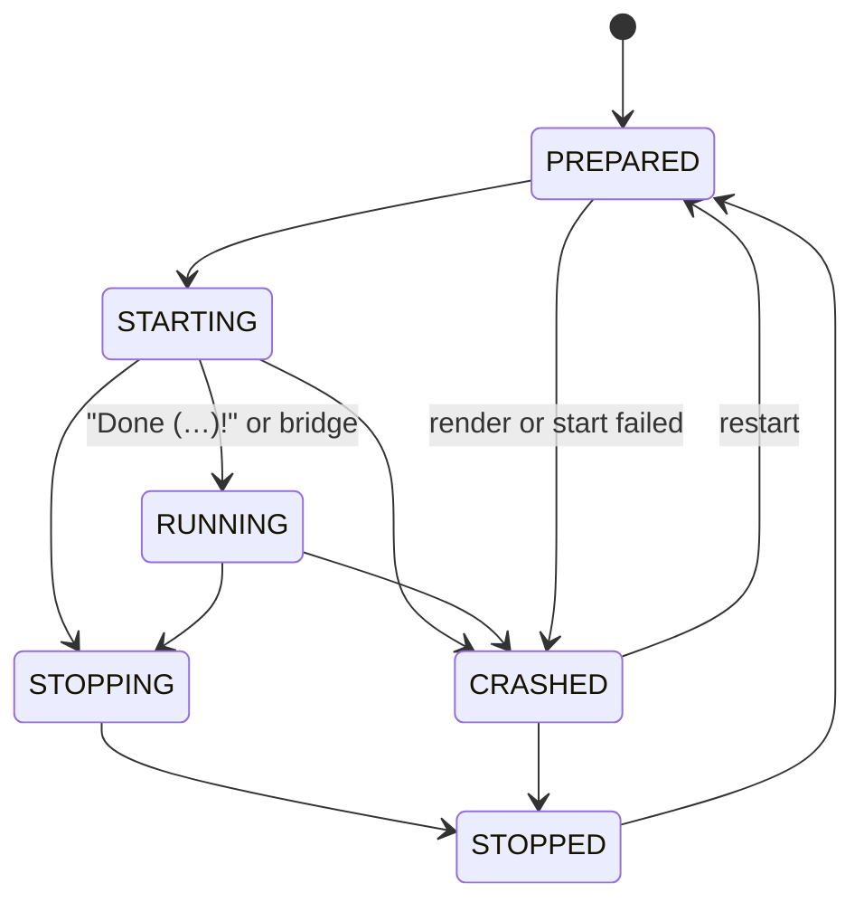

# VectoraCloud node: service core

`VectoraCloud/cloud-node` (package `net.vectora.cloud.node`) is the node itself. This page covers what exists so far: the entry point the launcher calls and the service core, which renders the wanted servers, starts them as plain Java processes, watches them, restarts them after a crash and stops them in stages. Console, network channel, scaling, JRE downloads and the bridges come in later pull requests; the interfaces they plug into are listed at the end.

## Start order

`NodeMain.start(Map<String, String>)` is called by the launcher (settings in [launcher.md](launcher.md#node-entry-point)). It:

1. checks the settings (`NodeSettings.parse`: `home` absolute, `language` `de` or `en`, booleans `true` or `false`);
2. opens the configuration (`ConfigService`) and generates missing secrets in `secrets/vectora.env`;
3. starts watching the configuration files;
4. ends orphaned servers from the previous run (see [Orphans](#orphans));
5. starts every planned service, but only if `cloud.yml` has `setup-complete: true` and `eula-accepted: true`. Otherwise it logs a warning and starts nothing;
6. keeps the JVM alive with the non-daemon thread `vectora-node` and registers the shutdown hook `vectora-shutdown`, which stops all services and closes the configuration.

A second `start` in the same JVM is an error.

## Which services run

A service is one running server process. The plan comes from the configuration:

- Each task in `tasks/` that runs on this node (`nodes` empty or containing `node-id`) gets `min-services` services of its group.
- A group whose `template` is one of the eight known folders (`Proxy`, `Lobby-Server`, `Survival-Server`, `Creative-Server`, `Mod-Server`, `End-Server`, `Database`, `Minigame-Server`) follows the `servers` switches in `cloud.yml`. An unwanted group is neither rendered nor started, and the proxy does not list it.
- `Database` is never a service; the database module (PR 12) runs it.
- A group on its own template folder counts as wanted.
- `max-services` caps the services per task, also for manual starts.

Backends start before proxies, so the proxy's server list is complete when it renders.

## Ids, folders and ports

| | Rule |
|---|---|
| Service id | `<group>-<index>`, index 1 to 9999, the lowest free index of the group. Example: `lobby-1`. |
| Folder, static task | index 1: `<home>/<template>/runtime`, index n: `<home>/<template>/runtime-<n>`. Kept after the stop: worlds and player data stay. |
| Folder, dynamic task | `<home>/temp/services/<id>`. Cleared before the start and deleted after the stop. Only direct children of `temp/services` are deleted, and links are not followed. While the folder of a stopped service is still being deleted (on Windows a locked file can delay this by a few seconds), its id is not handed out again; the next start takes the next free index. |
| Port, proxy | `cloud.proxy.port` (the software `velocity` marks a proxy). One proxy per node. |
| Port, other services | the first free port in the node's `service-ports`, skipping the node's fixed ports (proxy, Bedrock, legacy proxy, API, database, channel) and ports another program already has bound. Never two services on one port. |

Every start renders the template with [cloud-template](template.md) into the folder. Besides the secrets, the node provides `VECTORA_SERVER_HOST`, `VECTORA_SERVER_PORT`, `VECTORA_XMS`, `VECTORA_XMX`, `VECTORA_DB_HOST`, `VECTORA_DB_PORT`, `VECTORA_DB_NAME`, `VECTORA_DB_USER` and, for the proxy, `VECTORA_PROXY_BIND`, `VECTORA_PROXY_PORT`, `VECTORA_BEDROCK_PORT` and the server list. In the proxy list a static backend with index 1 appears under its group name (`lobby`), every other one under its id (`lobby-2`). The try list holds the lobby backends. Dynamic services are not written into `velocity.toml`; they register through the bridge (PR 13).

## Process

The node starts the server JVM directly with `ProcessBuilder`, without a wrapper jar (see [architecture](architecture.md#no-wrapper-jar)):

```
<java> -Xms<heap.min> -Xmx<heap.max> <process.jvm-flags> [-Dstdout.encoding=UTF-8 -Dstderr.encoding=UTF-8] -jar <software jar> [--nogui]
```

- `<java>` comes from the `JavaRuntimeResolver`. Today that is the JVM the node runs on. The JRE management (`JreManager` in `cloud-download`, PR 7) is wired in by a later pull request.
- The encoding flags are added from Java 18 on. `--nogui` is added for everything except Velocity.
- No shell is involved; flags are single arguments. Flags that would change heap, class path or the main jar (`-Xms…`, `-Xmx…`, `-jar`, `-cp`, `-XX:Flags=`, `-XX:VMOptionsFile=`, `-version`, `-help`, …) are rejected by the validator.
- The environment is the node's own without any `VECTORA_*` variable, plus:

| Variable | Value |
|---|---|
| `VECTORA_SERVICE_ID` | service id |
| `VECTORA_SERVICE_GROUP`, `VECTORA_SERVICE_TASK` | group and task name |
| `VECTORA_SERVICE_PORT` | the service's port |
| `VECTORA_SERVICE_TOKEN` | a new random token per start (32 bytes, base64url). The bridge proves its identity with it; the node compares it in constant time (`ServiceManager.verifyToken`). |
| `VECTORA_CLOUD_HOST`, `VECTORA_CLOUD_PORT` | where this node's channel listens (`nodes.yml`) |

## Life cycle



- **RUNNING** is reached when the output contains a line with `Done (` and `)!` (Paper, Fabric and Velocity print it) or when the bridge calls `markReady`.
- **Stop** goes in stages: the stop command on standard input (`stop`, for Velocity `shutdown`, or `process.stop-command`), then up to `process.stop-timeout` (default 60 s), then a normal termination request, 10 s later the forced end of the process and its children. On Windows the termination request already ends the process.
- **Exit:** a requested stop or exit code 0 ends in STOPPED, anything else in CRASHED.
- **Restart after a crash** (`process.restart`): with `on-crash: true` the service is prepared and started again after `backoff`, doubled for each further crash and capped at `max-backoff`. After `max-attempts` crashes in a row it stays CRASHED. A service that ran for 5 minutes starts counting from zero again.

Listeners (`ServiceListener`) get every state change and every output line and implement both methods (an empty body is fine). State changes arrive in order on one shared thread; output lines arrive in order on the output thread of each service.

## Configuration

Each group can have a `process` section; all of it is optional. Details in [config.md](config.md#groupsnameyml).

```yaml
process:
  jvm-flags: [-XX:+UseG1GC]
  stop-command: stop
  stop-timeout: 60s
  restart:
    on-crash: true
    max-attempts: 5
    backoff: 5s
    max-backoff: 300s
```

## Logs

The output of each service (standard output and standard error together) goes to `<home>/logs/services/<id>.log`. The previous five runs are kept as `<id>.1.log` to `<id>.5.log`. Every line is passed through the secret filter first: values from `vectora.env` and the service token are written as `***`, in the log and to listeners. Lines longer than 8192 bytes are split, invalid UTF-8 is replaced.

## `state/services.json`

On every state change the node writes all services to `<home>/state/services.json`, atomically (temporary file, flush, rename). Example:

```json
{
  "schema-version" : 1,
  "node" : "node-1",
  "services" : [ {
    "id" : "lobby-1",
    "group" : "lobby",
    "task" : "lobby",
    "index" : 1,
    "mode" : "static",
    "state" : "running",
    "pid" : 4242,
    "started-at" : 1700000000000,
    "port" : 30001,
    "work-directory" : "Lobby-Server/runtime"
  } ]
}
```

The file is read strictly: unknown fields, duplicate keys, an id that is not `<group>-<index>`, negative numbers, ports outside 1 to 65535 and folders that are not plain relative paths are errors. A broken file is moved aside as `services.json.broken-<millis>` and the node starts with an empty state. `ServiceStateStoreFuzzTest` fuzzes the reader.

## Orphans

If the node ends without stopping its services (crash, power loss, `kill -9`), the servers may still run. At the next start the node reads `state/services.json` and, for each service with a pid:

- ends the process if the pid exists and its start time matches the recorded one (within one second): a termination request, then the forced end after the group's `stop-timeout`;
- leaves it alone if the start time differs: the pid now belongs to another program;
- blocks the folder and the port for this run if the start time cannot be read, so no second server opens the same world. The id is reported as unverifiable.

Afterwards the leftover folders in `temp/services/` are deleted, except blocked ones.

## Interfaces for the next pull requests

| Interface | Default | Who plugs in |
|---|---|---|
| `service.JavaRuntimeResolver` (`resolve(group, config)` returns `JavaRuntime(executable, featureVersion)`) | `JavaRuntimeResolver.current()`, the node's own JVM | `JreManager` from PR 7, wired in later |
| `service.ServerSoftwareProvider` (`provide(spec, folder)` returns the jar name) | `existingJar()`: the jar must already be in the folder | PR 14, downloads |
| `service.PlaceholderContributor` (extra placeholder values; the node's own values win) | none | PR 12 (database), PR 24 (legacy proxy) |
| `ServiceManager.addListener(ServiceListener)` | none | PR 10 (console output), PR 11 (monitoring), PR 9 (events on the channel) |
| `ServiceManager.sendCommand(id, line)` | 1 to 1024 characters, no control characters | PR 10, console |
| `ServiceManager.start(task)`, `stop(id)`, `services()`, `find(id)` | | PR 10, PR 15 (scaling) |
| `ServiceManager.verifyToken(id, token)`, `markReady(id)` | | PR 9 and PR 13, channel and bridges |
| `CloudNode.open(settings, builder -> …)` | | every module that adds one of the above |

## Limits today

- Server software is not downloaded yet. Until PR 14, a service only starts if its jar is already in the folder (`paper.jar`, `velocity.jar`, `fabric-server.jar`, `pandaspigot.jar`).
- `service-ports` and `node-id` are read once when the node starts; a change needs a restart.
- One proxy per node. The legacy proxy (PR 24) adapts the port rule.
- No scaling: tasks run exactly `min-services` services. PR 15 adds scaling.
